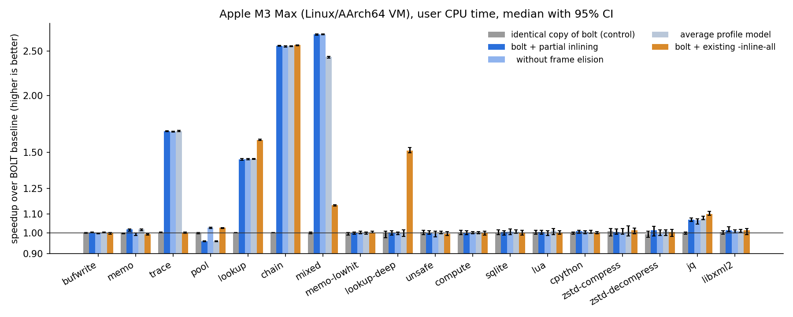

# Profile-Guided Partial Inlining with Frame Elision for LLVM BOLT

| | |
|---|---|
| **Component** | LLVM BOLT (`llvm-bolt`), new pass `partial-inlining` |
| **Base** | llvm-project `main` @ `1be60cbf47e9b102a653f9cb54fc965fe71a1ec4` (2026-11-25) |
| **Option** | `--partial-inline` (off by default) |
| **Targets** | AArch64 (complete, incl. frame elision and saved registers), x86-64 (frameless fast paths) |
| **Patch** | [`patches/0001-BOLT-Add-profile-guided-partial-inlining-of-fast-paths.patch`](../patches/0001-BOLT-Add-profile-guided-partial-inlining-of-fast-paths.patch) |

## Contents

1. [Summary](#1-summary)
2. [Problem description](#2-problem-description)
3. [Design](#3-design)
4. [Implementation](#4-implementation)
5. [Experimental evaluation](#5-experimental-evaluation)
6. [When the optimization is (in)effective](#6-when-the-optimization-is-ineffective)
7. [Limitations and future work](#7-limitations-and-future-work)
8. [Reproducing the results](#8-reproducing-the-results)

---

## 1. Summary

Many hot functions consist of a short *fast path* that returns early and a much
larger *slow path*: a cache lookup that hits, a buffer that still has room, a
logging call whose level is disabled, an allocator whose free list is not
empty. They are too large for the compiler to inline, cannot be inlined across
translation units without LTO, and are frequently not shrink-wrapped, so each
call executes a call, a return and the complete prologue and epilogue to run a
handful of useful instructions.

This work adds **profile-guided partial inlining** to BOLT. For every hot direct
call site it copies the callee's hot, acyclic fast region into the caller,

* **elides the callee's stack frame** on the copied path (stack pointer
  updates, callee-saved spills and reloads, frame pointer setup, return address
  signing/authentication, CFI, BTI landing pads),
* **renames** callee-saved registers that the fast path uses as temporaries to
  scratch registers that are provably dead at the call site,
* copies the **first iteration of a loop** on the fast path (a hash chain
  lookup that usually hits the first node) and leaves the loop through its
  back edge,
* **saves and restores** an argument register that the fast path overwrites
  before it decides (`p = p->next`; AArch64),
* and **falls back to the original call** on every slow exit. The copied
  region is guaranteed to be side-effect free and *re-executable* on every
  path to a slow exit, so the callee itself is not modified at all.

A conservative **worst-case profile model** compensates for BOLT's
context-insensitive profiles, and the transformation is applied hottest-first
under a coverage budget.

Key results on an Apple M3 Max (Linux/AArch64 VM), BOLT baseline vs. baseline
+ `--partial-inline`, see [Section 5](#5-experimental-evaluation):

* **clang: 1.015x** [1.013, 1.017] (p = 9e-9).
  - **What was measured:** compilation, against Clang-BOLT. clang is built
    and trained with the in-tree Clang-BOLT rules and timed on three
    translation units that are not part of its training.
  - **What the pass does:** it transforms 2,115 call sites, 606 of them with
    frame elision. It avoids an estimated 22% of the profiled direct calls
    and 2.1% of the executed instructions, for 0.39% more hot code.
  - **Compared with `-inline-all`:** BOLT's existing whole-function inliner
    gives 1.006x and grows the hot code by 20%. On top of it, the pass adds
    1.010x [1.008, 1.012].
  - **Robustness:** the gain does not depend on the branch-relaxation change
    described under jq: with the previous relaxation it is 1.014x.
* **Up to 2.73x** faster on code dominated by fast-path calls (`mixed` 2.73x,
  `trace` 1.66x, `memo` 1.067x; 13-16% fewer executed instructions).
  - Frame elision is what makes `memo` profitable: the compiler did not
    shrink-wrap its callee, and without frame elision the pass does not
    transform it.
  - `memo`'s loop is bound by store-to-load chains, and its speedup varies
    between runs more than the confidence interval suggests. The same
    binaries measured 1.020x in the first, unpublished run of this version,
    and version 1.3.1 measured 1.018x.
* **Loops and overwritten arguments.** With fast paths through the first
  iteration of a loop and saved argument registers, the pass speeds up two
  microbenchmarks that version 1.2.0 left unchanged:
  - a hash chain lookup (`lookup`): 1.47x;
  - a function that advances its argument before it decides (`chain`): 2.57x.

  BOLT's existing `-inline-all` is as fast or faster on both (1.61x and
  2.59x), because their callees are small leaf functions without a frame
  that it inlines as a whole. In the real programs the extensions matter
  more:
  - in SQLite, Lua, CPython and zstd they add 8 call sites, 5 of them with
    frame elision;
  - in clang, 59 call sites run through the first iteration of a loop and
    220 save a register;
  - without the extensions the pass avoids 19.7% instead of 22.1% of clang's
    direct calls, and clang compiles 1.012x instead of 1.015x faster.
* **jq 1.8: 1.124x** [1.119, 1.128], but most of this gain compensates for a
  recent change of the baseline.
  - **The change:** since 2026-11-23, upstream BOLT relaxes AArch64 branches
    with clusters by default. jq's BOLT binary then executes 4.5% more
    instructions than the original binary and runs 11% slower than with the
    previous stub insertion.
  - **With the previous relaxation,** the pass gives 1.068x [1.064, 1.072],
    as in version 1.3.1 (1.069x).
  - **Most of that** comes from a one-instruction callee (`jv_get_kind`)
    that BOLT's existing `-inline-all` inlines as well. Without it, the pass
    gives 1.017x [1.009, 1.022]. On top of `-inline-all` it adds 1.018x
    [1.007, 1.021].
* **Other real programs** (SQLite, Lua, CPython, zstd, libxml2): no reliable
  run-time change, all within 0.8% of the baseline.
  - The pass removes up to 46% of the direct calls (zstd, a single call
    site), and between 1.48% fewer and 0.59% more executed instructions.
  - Lua's 1.008x [1.002, 1.010] disappears with the previous branch
    relaxation (0.999x), like most of jq's gain.
* **zstd's profile was incomplete in versions 1.0.0-1.3.1** (Section 5.7):
  the decompression run of its training overwrote the profile of the
  compression run. With a complete profile, the pass transforms one call
  site on the compression path. That fast path runs through a loop's first
  iteration with a saved register, and it executes 0.59% more instructions
  there, without a measurable change in run time (1.007x [0.991, 1.029]).
* **What limits the pass on real programs** (Section 5.6):
  - 16-42% of the function entries in the profiles of SQLite, Lua, CPython,
    jq and libxml2 have no caller that BOLT rewrites (9% in clang).
  - The interpreter loops of Lua, CPython, jq and SQLite are not simple for
    BOLT, and many of the hottest calls come from them.
  - Of the remaining direct calls, the largest groups go to library
    functions through the PLT and to functions whose every path calls
    another function, both outside the scope of the pass.
* **No regression** on workloads without the pattern or with unsafe fast
  paths (`compute`, `unsafe`, `memo-lowhit`, `lookup-deep`). The pass
  transforms no call site in `unsafe`, `memo-lowhit` and `lookup-deep`
  (identical executed instructions), and only a lukewarm call site in
  `compute`. The run time is unchanged.
* **Costs:** code grows by at most 0.6% on the real programs. BOLT's
  processing time grows by 7% on clang (20.1 s to 21.5 s) and by at most
  0.08 s on the other programs.
* **One microbenchmark loses:** `pool` is 5% slower although it executes
  25% fewer instructions.
  - Its loop is bound by two values that both inlined fast paths store to
    memory and load again.
  - Section 5.5 shows that on this core the run time of such a loop reacts
    non-monotonically to the number of instructions between a store and the
    load that reads it back. Adding or removing single instructions gives
    0.82x to 1.08x of the baseline, independent of block order and code
    placement.
  - The pass has no cost model for this. A compiler that inlines both
    callees keeps the values in registers instead, which needs alias
    information that a post-link optimizer does not have.
* **The evaluation was checked for measurement bias** (Section 5.7).
  - Profiles are reproducible (clang's up to a few edge counts), every
    variant runs from the same path, and an A/A control bounds the
    resolution at about +-1% within a run. Between runs, results vary by up
    to 2%, and by more for loops bound by store-to-load chains.
  - That check showed that the 2.5% Lua speedup reported by an earlier
    snapshot of this work was an artifact: each variant ran under its own
    file name from its own file pages.
  - The workload builds are reproducible as well (Section 5.2).

The patch adds 9 lit tests (one of them executes PAC-protected binaries end to
end); the full BOLT test suite shows **no change in the result of any existing
test**, and with the option disabled the patched `llvm-bolt` produces
**byte-identical output** to unmodified mainline on all evaluated workloads.

## 2. Problem description

### 2.1 Fast paths pay for the call and the frame

Consider a direct-mapped memoization cache in front of an expensive function,
in a different translation unit than its callers (`benchmarks/micro/memo`):

```c
uint64_t memo_get(uint64_t key) {
  struct entry *e = &cache[(key ^ (key >> 12)) & 4095];
  if (e->key == key + 1)            // ~98% of the calls
    return e->val;
  uint64_t v = expensive(key);      // slow path: call, needs a frame
  e->key = key + 1; e->val = v; memo_misses++;
  return v;
}
```

clang 23 at `-O2` produces (AArch64):

```asm
memo_get:
  stp  x29, x30, [sp, #-0x20]!   ; prologue - executed on every call
  stp  x20, x19, [sp, #0x10]
  mov  x29, sp
  eor  w8, w0, w0, lsr #12
  adrp x9, cache
  add  x9, x9, :lo12:cache
  add  x20, x0, #0x1             ; key+1 kept in callee-saved x20 ...
  and  x8, x8, #0xfff
  add  x19, x9, x8, lsl #4       ; ... and &cache[i] in x19: both are live
  ldr  x8, [x19]                 ;     across the call on the slow path
  cmp  x8, x20
  b.ne .Lmiss
  ldr  x0, [x19, #0x8]           ; fast path result
  b    .Lepilogue
.Lmiss:
  bl   expensive
  ...
.Lepilogue:
  ldp  x20, x19, [sp, #0x10]     ; epilogue - executed on every call
  ldp  x29, x30, [sp], #0x20
  ret
```

The fast path is 10 useful instructions, but every call also executes `bl`,
`ret`, two stores and two loads of callee-saved registers, the frame pointer
setup and two stack pointer updates. Shrink-wrapping (moving the prologue onto
the slow path) is impossible for the compiler because `x19`/`x20` are computed
before the branch and are needed after the call on the slow path, so they must
live in callee-saved registers that have to be saved first. This is not a
corner case: in our microbenchmarks clang 23 did not shrink-wrap 3 of the 8
fast-path functions (`buf_putc`, `memo_get`, `pool_alloc`). GCC 13.3 does not
shrink-wrap `trace_event` either: it executes the complete 320-byte frame
setup, including the stack-canary load and store of Ubuntu's default
`-fstack-protector-strong`, before the level check.

Compilers address this pattern with *partial inlining* (GCC `ipa-split`, LLVM
`PartialInliner`), but only at the IR level within one module (LLVM's pass is
not part of the default pipeline), and never across translation units without
LTO. A post-link optimizer sees the whole program and an accurate profile, but
BOLT currently has no such transformation.

### 2.2 What BOLT offers today

BOLT's `Inliner` (`bolt/lib/Passes/Inliner.cpp`) inlines *whole* functions:

* `--inline-small-functions` only inlines callees whose body is at most
  `--inline-small-functions-bytes` (default 4 bytes, i.e. one instruction on
  AArch64);
* `--inline-all` inlines every call site of every callee that does not touch
  the stack pointer (except via push/pop on x86); on AArch64 any function with
  a frame is only inlined at tail call sites. Neither mode uses the profile to
  select call sites, so they are rarely enabled.

None of BOLT's passes copies *part* of a callee, elides a callee's frame, or
renames registers across function boundaries.

### 2.3 Goal

Remove call, return and frame overhead from the hot fast paths of non-inlined
functions using BOLT's profile, without changing program semantics, without
modifying the callee, and without slowing down code that does not have this
pattern.

## 3. Design

### 3.1 Terminology

For a callee `F`:

* the **fast region** `R` is a set of basic blocks of `F` that contains the
  entry, contains no calls, indirect branches or jump tables, and from every
  block of which a return is reachable within `R`. If blocks of `R` form a
  loop in `F`, its back edges are *cut*: they do not belong to `R`, which is
  therefore acyclic and contains the first iteration of the loop only;
* a **fast exit** is a return in `R`;
* a **slow exit** is a CFG edge from a block of `R` to a block outside `R`, or
  a cut back edge.

For a call site `S: call F` in caller `G`, the pass creates a copy `R'` of `R`
in `G`. Fast exits of `R'` continue after the call (or return, at tail call
sites); slow exits of `R'` branch to a new block `SLOW` that contains the
original call instruction (with all its annotations: EH landing pad, GNU args
size, RA state, call count) followed by a branch to the code after the call.
If `R'` overwrites registers that `F` needs again (3.2), `R'` starts with
copies of these registers to scratch registers, and `SLOW` copies them back
in front of the call.

```
            G (before)                     G (after)
      +----------------+            +----------------+
      | ...            |            | ...            |
      | bl F           |            +--------+-------+
      | <continue>     |                     v
      +----------------+            +-----------------+ slow exit +--------+
                                    | R' (fast region |---------->| bl F   |
                                    |  of F, no frame)|           +---+----+
                                    +--------+--------+               |
                                    fast exit|                        |
                                             v                        |
                                    +----------------+                |
                                    | <continue>     |<---------------+
                                    +----------------+
```

### 3.2 Correctness: the re-execution fallback

When `R'` takes a slow exit, `F` is called and executes *from its entry*,
re-executing the instructions `R'` already executed. This is equivalent to the
original program if, on every path `P` from the entry of `R` to a slow exit:

1. **No side effects.** No instruction on `P` writes memory or has unmodeled
   side effects (stores, atomics, exclusive accesses, barriers, system
   register writes, ...). Instructions on paths that can no longer reach a slow
   exit (after the fast/slow decision) may store - e.g. the free-list update
   in `pool_alloc` or the buffer append in `buf_putc`.
2. **Entry values are intact.** A register that is read on `P` before it is
   defined on `P` carries a value from the entry of `F`, usually an argument. Such a
   register must have its entry value when the call in `SLOW` executes.
   Either no path to a slow exit writes it, or `R'` saves it in a scratch
   register before its first instruction and `SLOW` restores it (3.4). An
   example is a lookup that advances its argument, `p = p->next`, before it
   decides. Then, by induction over the instructions of `P`, the re-executed
   `F` reads the same values, takes the same branches, and reaches the slow
   exit with exactly the architectural state of the original call.
3. **Fresh scratch registers.** The scratch registers introduced for renaming
   and saving (3.4) are not read by `F` before being written (they are
   caller-saved non-argument registers and `F`'s own code is checked).

A loop does not change the argument. `R'` executes the first iteration; when
the loop would continue, `R'` takes the cut back edge, a slow exit, and `F`
starts over from its entry and iterates itself. Conditions 1 and 2 hold for
the paths to the cut edges like for any other path to a slow exit: a loop
that stores before its exit test, for example, has no fast region.

On a fast exit, `R'` has performed exactly `F`'s computation and memory
accesses on that path, except for the elided frame instructions, which only
touch `F`'s own (dead after return) stack frame, the return address register
and callee-saved registers that are restored before `F` returns. Registers
clobbered by `R'` are either clobbered by `F` on the same path or are scratch
registers that are dead after the call (3.4). Because `R'` never changes the
stack pointer, the frame pointer or the link register, the caller's unwind
information remains valid for every instruction of `R'`; `R'` contains no
calls, so it cannot throw.

Concurrency: `R'` only reads memory before a slow exit, so a slow-exit
execution is indistinguishable from an execution in which the discarded
speculative reads never happened and `F` was entered at the time of the call.

### 3.3 Fast region formation

`PartialInlining::buildRegion()` computes `R` from the CFG and the profile:

1. **Candidates**: blocks reachable from the entry through *copyable* blocks
   (no calls, no indirect branches, no jump tables, no EH labels, no landing
   pads, symbolic operands must not reference callee-local labels or jump
   tables; exploration is bounded).
2. **Acyclicity**: a depth-first search from the entry cuts every edge that
   leads to a block on the search stack. Every cycle contains such a back
   edge, so the remaining graph is acyclic. The cut edges are slow exits.
3. **Usefulness**: keep only blocks from which a return is reachable. A loop
   latch whose only way to a return is the cut back edge is dropped here, and
   the edges into it become the slow exits; a latch with another exit (the
   end of the chain) stays in the region.
4. **Profile flow**: in topological order compute the flow from the entry
   (`Flow`) and, backwards, the probability of leaving through a fast exit
   (`PFast`) from the edge counts. `FastProb = PFast(entry)`.
5. **Cold pruning**: blocks reached by less than 1% of the invocations are
   removed (they add size and hazards but no benefit).
6. **Frame/dataflow analysis** (3.5) in topological order.
7. **Slow reachability**, **side-effect check** (condition 1) and **hazard
   check** (condition 2, a forward must-define analysis restricted to blocks
   that can reach a slow exit). Registers that violate condition 2 are
   recorded for saving if the target can copy them (3.4).
8. **Size limits** (`--partial-inline-max-insns`, `--partial-inline-max-blocks`).

Any violation in a non-entry block *prunes* that block (its incoming edges
become slow exits) and the analysis is repeated; a violation in the entry
block rejects the callee. Pruning makes the region the maximal safe and warm
prefix of `F`. When pruning removes all fast exits, the first pruning reason is
reported, which makes the rejection statistics informative.

### 3.4 Register renaming and scratch registers

Callee-saved registers that the fast path writes after spilling them (`x19`,
`x20` in `memo_get`) belong to the *caller* in `R'` and must not be clobbered.
Every occurrence is renamed (including sub-registers, e.g. `w19`) to a scratch
register `s` of the same class. A renamed register may only be read after it
has been written on *every* path (a must-analysis; reading the entry value of a
callee-saved register is rejected).

Callee-side requirements for `s` (computed once per callee): `s` is a
caller-saved, non-argument register (AArch64: `x9`-`x15`, `v16`-`v31`; `x16`/
`x17` are excluded because BOLT's long-branch stubs use them), it is not
referenced by the copied code, and `F` never reads it before writing it
(condition 3).

Call-site requirements: `s` must be dead after the call in `G` *and* in `G`'s
callers. A plain ABI argument is not sufficient: interprocedural register
allocation (GCC's `-fipa-ra`, enabled at `-O2`) lets a caller keep values in
caller-saved registers across calls to callees known not to clobber them. The
pass therefore uses BOLT's interprocedural `RegAnalysis` and accepts `s` if

* the call to `F` already clobbers `s` (`RegAnalysis` clobber set of `F`), or
* a forward search from the call finds no read of `s` before it is redefined
  or clobbered (calls modeled with their `RegAnalysis` clobber/use sets) and,
  if the search reaches an exit of `G`, `G` itself already clobbers `s`.

Either way the clobber set of every function is unchanged by the
transformation, so `RegAnalysis` stays valid while the pass transforms
multiple call sites.

**Saved registers.** The registers recorded by the hazard check (condition 2)
get a scratch register in the same way, with the same callee-side and
call-site requirements, and distinct from the ones used for renaming. `R'`
then starts with `mov s, r`, and `SLOW` executes `mov r, s` in front of the
call, on every path, whether or not the register was overwritten on it. The
fast path pays one register copy per call. The copies are created by a new
target hook, `MCPlusBuilder::createRegisterCopy()`, which is implemented for
AArch64 general purpose registers. A hazard on any other register
(floating-point and vector registers, flags, every register on x86-64) still
prunes the block or rejects the callee.

### 3.5 Frame elision

Frame instructions are recognized by a new target hook
`MCPlusBuilder::analyzeFrameInstruction()` that classifies an instruction as
`SPAdjust`, `Save` (registers stored to SP-relative slots, with pre-index
writeback), `Restore`, `FPSetup`, `SignRA`, `AuthRA` or `LandingPad`. A forward
abstract interpretation tracks, per region path, the SP offset relative to the
entry, a map *slot -> register whose entry value is stored there*, the set of
saved registers, the may/must sets of saved registers modified by the body,
whether FP was modified and whether the return address is signed. The rules:

* a save must store the *entry value* of a register into `F`'s own frame (below
  the entry SP) into a fresh slot; a restore must reload a register from the
  slot holding its saved value;
* at every fast exit SP is back at its entry value, all modified saved
  registers have been restored, FP is restored, and the return address is
  either not signed or authenticated by the return itself (`retaa`);
* body (non-frame) instructions must not read or write SP, FP or LR - so the
  fast path may not use locals, spills or stack arguments;
* join points must agree on the frame state.

All frame instructions, CFI and landing pads are dropped from `R'`; the copies
get the CFI state and the pointer-authentication RA state of the call site.

### 3.6 Profile model and call-site selection

BOLT profiles are context-insensitive: `FastProb` describes all calls of `F`
together. A call site that only exercises `F`'s slow path would pay for the
duplicated fast-path check. With the default **worst-case model** the pass
assumes that all `SlowCalls(F) = Count(F)·(1 - FastProb)` invocations could
come from the call site under consideration:

```
p_site = min(FastProb, max(0, 1 - SlowCalls(F) / Count(S)))
```

For a dominant call site `p_site = FastProb`; for a minor call site of a
callee with a significant slow path `p_site` drops to 0. Call sites with
`p_site < --partial-inline-min-fast-ratio` (60%) are skipped. Only call sites
with a count of at least `--partial-inline-min-count` (default: BOLT's hot
threshold, half the average function execution count) are analyzed; they are
transformed in decreasing order of `Count(S)·p_site` until
`--partial-inline-coverage` (99%) of the eligible fast-path calls are covered.
`--partial-inline-profile-model=average` uses `FastProb` for all call sites
(ablation in Sections 5.3 and 5.5).

`FastProb` follows the edge counts through the region and thereby assumes
that a block branches the same way whenever it executes. This does not hold
for a block that is also entered from outside the region: the counts of a
loop header mix the first iteration with the later ones, which may well leave
the header differently. Whatever the correlation, an invocation that leaves
the region takes a slow-exit edge at least once, so the sum of the profile
counts of the slow-exit edges bounds the number of slow invocations from
above. The worst-case model uses the larger of the two values as
`SlowCalls(F)`. For a region without flow from outside both are equal. For a
chain lookup whose header executes 1.5 times per call, the flow may predict
67% fast calls where the bound guarantees only 50%; such a call site is
skipped (lit test `partial-inline-loop.s`).

### 3.7 Profile maintenance

* The copies `R'` receive `Count(S)/Count(F)` of the region flow of `R`; the
  `SLOW` block receives the flow of all slow exits and its call instruction's
  `Count` annotation (used by the call graph for function reordering) is set
  accordingly.
* The callee keeps its code but loses the fast-path flow that now executes in
  the caller: for every block and edge of `R` the pass subtracts
  `Scale·Flow·PFast`, and `F`'s execution count is reduced by the number of
  calls that no longer reach it.

### 3.8 Pipeline placement and interaction with other passes

The pass runs after `Inliner` and the second `IdenticalCodeFolding`, and before
`ReorderBasicBlocks`, `SplitFunctions` and `ReorderFunctions`:

* whole-function inlining keeps priority where it applies;
* block reordering lays out the copied fast path in line with the caller's hot
  path and moves the `SLOW` block out of the way; function splitting can move
  it to the cold fragment;
* function reordering sees the reduced call frequencies;
* `LongJmp`, `AArch64RelaxationPass` and `PointerAuthCFIFixup` handle long
  branches, ADR relaxation and RA state CFIs of the new blocks as for any other
  code. The pass is disabled together with `--instrument`.

### 3.9 Options

| Option | Default | Meaning |
|---|---|---|
| `--partial-inline` | off | enable the pass |
| `--partial-inline-max-insns` | 24 | max. instructions copied per call site |
| `--partial-inline-max-blocks` | 8 | max. blocks in a region |
| `--partial-inline-min-fast-ratio` | 60 | min. fast-path percentage per call site |
| `--partial-inline-profile-model` | `worst-case` | `worst-case` or `average` |
| `--partial-inline-min-count` | 0 (= hot threshold) | min. call site count |
| `--partial-inline-coverage` | 99 | share of eligible fast-path calls to cover |
| `--partial-inline-frame-elision` | on | allow frame elision |
| `--print-partial-inline` | off | print modified functions |
| `--partial-inline-min-block-flow` (hidden) | 1 | cold block pruning threshold (%) |
| `--partial-inline-loops` (hidden) | on | allow regions through the first iteration of a loop |
| `--partial-inline-save-regs` (hidden) | on | allow saving registers that the region overwrites |
| `--partial-inline-max-sites` (hidden) | 0 | limit for bisecting |
| `--partial-inline-skip` (hidden) | - | functions never partially inlined |

`-v=1` prints every transformed call site, `-v=2` also prints why a callee has
no usable fast region; `-debug-only=bolt-partial-inline` dumps the analysis.

## 4. Implementation

### 4.1 Code

| File | Change |
|---|---|
| `bolt/include/bolt/Passes/PartialInlining.h`, `bolt/lib/Passes/PartialInlining.cpp` | the pass (~1,750 lines incl. comments) |
| `bolt/include/bolt/Core/MCPlusBuilder.h` | 4 new target hooks with conservative defaults |
| `bolt/lib/Target/AArch64/AArch64MCPlusBuilder.cpp` | AArch64 frame instruction classifier, scratch registers, register copies, zero-extension model |
| `bolt/lib/Target/X86/X86MCPlusBuilder.cpp` | `endbr` landing pads, 32-bit zero-extension model |
| `bolt/lib/Rewrite/BinaryPassManager.cpp` | pass registration, `--print-partial-inline` |
| `bolt/docs/*.md` | user documentation, command-line reference, AArch64 status |
| `bolt/test/**/partial-inline*` | 9 lit tests |

The new target hooks are:

* `analyzeFrameInstruction(Inst, FrameInstrInfo&)` - frame instruction
  classification (AArch64: `ADD/SUB SP, SP, #imm`, `ADD FP, SP, #imm`,
  `STP/STR/STUR` and `LDP/LDR/LDUR` of X and D registers with offset, pre- and
  post-index addressing based on SP, `PACI[AB]SP`, `AUTI[AB]SP`, `BTI`).
* `getCallSiteScratchRegs(Reg, Regs)` - ABI scratch registers of the same
  class.
* `getFullyDefinedReg(Reg)` - the register completely defined by a write to
  `Reg` (`W0 -> X0`, `S0 -> Q0` on AArch64; `EAX -> RAX` on x86-64), used to
  make the must-define analysis precise.
* `createRegisterCopy(Inst, Dst, Src)` - a register copy without any other
  effect (AArch64: `mov Xd, Xm`), used to save and restore registers (3.4).

The pass is organized in four phases: lazy per-callee analysis
(`analyzeCallee`, `buildRegion`, `computeScratchCandidates`), call-site
collection and selection, transformation (`chooseScratchRegisters`,
`inlineFastPath`, `updateCalleeProfile`; call sites of one block are processed
from the last to the first so recorded positions stay valid), and statistics.
The transformation runs sequentially and is deterministic.

### 4.2 Issues found and fixed during development

Systematic testing on compiler-generated code exposed several subtle issues
that a less careful implementation would get wrong:

| Issue | Consequence | Fix |
|---|---|---|
| A write to `w8` defines all of `x8` on AArch64, but BOLT register sets only contain sub-registers of a written register | spurious hazards (`and x8, x8, ...` after `eor w8, ...`) | `getFullyDefinedReg` hook |
| `XZR`/`WZR` are constant, but their sub-register `WZR_HI` is not marked constant | every `cmp` (writes XZR) and `mov` (reads XZR) looked like a hazard | close the constant set over sub-registers |
| Full alias sets contain register tuples (`X8_X9`, `X8..X15` for `LD64B`) | `x10` conflicted with a region using `x8` | compare *storage* (fully defined register + sub-registers) |
| A renamed register read after a join where only one predecessor wrote it | **miscompile**: scratch register read on the other path | must-dirty analysis; regression test, verified by mutation testing |
| `isPAuthAndRet` aborts on x86 | crash on x86 | query only on AArch64 |
| `x16/x17` are used by BOLT's long-branch stubs without liveness checks | possible clobber of a renamed value | exclude from scratch candidates |
| GCC `-fipa-ra` callers keep values in caller-saved registers | possible miscompile with ABI-only reasoning | `RegAnalysis`-based scratch selection (3.4) |
| Cold slow-path blocks reaching returns entered the region | spurious hazards, size | cold pruning + conflict-driven pruning |
| The edge counts of a loop header mix the first iteration with later ones | the flow through the region overestimates the share of calls that return from the copy | bound the slow invocations by the counts of the slow-exit edges (3.6) |

### 4.3 Testing

* **Lit tests** (all new, all passing):
  * `AArch64/partial-inline-frameless.s` - CFG after the pass (copied blocks,
    slow block, profile counts, call count annotation), callee unchanged,
    callee profile reduced, pass off without the option;
  * `AArch64/partial-inline-frame-elision.s` - prologue/epilogue elision and
    renaming of `x19`/`x20`; with frame elision disabled the callee is rejected;
  * `AArch64/partial-inline-reject.s` - 10 hot callees that must not be
    transformed (store before the decision, barrier, clobbered floating-point
    argument, SP use, LR use, stack argument, unrestored callee-saved register,
    partially written renamed register, cold fast path, loop at the entry that
    usually iterates);
  * `AArch64/partial-inline-loop.s` - a chain lookup: the copy contains the
    first iteration, the back edge branches to the original call, and the end
    of the chain is a second fast exit; a lookup that iterates more often is
    only transformed with the average profile model; a loop that stores before
    its back edge is rejected;
  * `AArch64/partial-inline-save-regs.s` - an argument register that is
    overwritten before the decision is saved and restored, without a frame,
    together with frame elision and renaming, and at a tail call site;
  * `AArch64/partial-inline-sites.s` - tail call sites, worst-case vs. average
    model, `--partial-inline-min-fast-ratio`, `--partial-inline-min-count`;
  * `AArch64/partial-inline-pauth.s` - BTI landing pads and PAC signing/
    authentication are elided, RA states stay consistent;
  * `X86/partial-inline.s` - frameless fast path with `endbr64`, stack-using
    callee rejected;
  * `runtime/AArch64/partial-inline.c` - end to end on the host: compile at
    `-O2`, instrument, train, optimize, run, compare outputs; repeated with
    `-mbranch-protection=standard`, which on this CPU (FEAT_PAuth) faults on a
    wrong frame elision. The program includes a chain lookup and a function
    that overwrites its argument register, whose slow paths run about 6% of
    the time and change the output if the fallback call gets a wrong argument.
* **Mutation tests**: re-introducing the must-dirty bug makes
  `partial-inline-reject.s` fail. Four injected bugs in the code for loops
  and saved registers (no restore in front of the fallback call, no save at
  the start of the copy, a cut back edge that is not treated as a slow exit,
  a back edge that branches to the copied loop header) each make
  `partial-inline-loop.s` or `partial-inline-save-regs.s` fail, and the two
  save/restore bugs also change the output of the end-to-end test.
* **Extensions off**: with `--partial-inline-loops=false
  --partial-inline-save-regs=false` the pass writes byte-identical binaries
  to the pass of version 1.2.0 for all 14 workloads of that version.
* **Regression**: `check-bolt` for unmodified mainline and the patched tree with
  the same toolchain ([Section 5.8](#58-correctness-and-regression-testing)).
* **x86-64**: 11 programs validated end to end under emulation (Section 5.8).
* **Output equivalence**: every benchmark run of every variant is checked
  against the output of the original binary (exit code and SHA-256 of stdout).
* **Flag-off identity**: the patched `llvm-bolt` without `--partial-inline`
  produces byte-identical binaries to mainline `llvm-bolt`.

## 5. Experimental evaluation

All numbers in this section come from one continuous run of
`scripts/run_experiments.sh` in the Docker image built from this repository
(`make image experiments`); the results are in [`results/`](../results/)
(raw per-run CSV files, summaries, `REPORT.md`, plots, BOLT logs). The
exceptions are marked where they occur: comparisons with the runs of earlier
versions, and exploratory tests outside the published run (Sections 5.6 and
5.7).

### 5.1 Setup

| | |
|---|---|
| Hardware | Apple M3 Max (12 performance + 4 efficiency cores), FEAT_PAuth |
| OS | Docker Desktop 4.99 Linux VM, kernel 7.0.14 (aarch64), 12 vCPUs, 31 GiB; Ubuntu 24.04 container. No other container ran on the VM (in the runs of versions 1.0.0-1.2.0, an unrelated, mostly idle database container used about 3-4% of one vCPU) |
| Compiler | clang/lld 23.1.6 (apt.llvm.org), no LTO, no PGO, `-Wl,--emit-relocs`; `-O2` for the microbenchmarks, SQLite and Lua, the projects' defaults for the others (`-O3` for CPython, zstd and clang, `-O2` for jq and libxml2) |
| BOLT | mainline `1be60cbf47e9` (2026-11-25; Release + assertions), baseline and patched. Since 2026-11-23, upstream BOLT relaxes AArch64 branches with clusters by default (`-relax-with-clusters`, commit `62a5ff06d`). All variants use this default except `bolt-nocl` and `bolt-pi-nocl` |
| Profile | BOLT instrumentation (`-instrument`) on *training* inputs that are smaller than (zstd, clang: different from) the evaluation inputs; the same profile is used for all variants. Training runs with several processes (zstd: compression and decompression; clang: several hundred compiler invocations) write one profile per process, and `merge-fdata` merges them. Profiles, and therefore all BOLT outputs, are byte-for-byte reproducible: the training runs execute with address space layout randomization disabled (`setarch -R`), CPython with `PYTHONHASHSEED=0`, and Lua is built with a fixed hash seed (`-Dluai_makeseed()=0u`) instead of one derived from the clock and a stack address. Without these measures Lua, SQLite and CPython produce a slightly different profile in every run, because some of their hash tables depend on addresses. clang is the exception: in two preparations in the release image, 111 of its 693,306 edge counts differed, by 25,588 of 30.7 billion, in maps keyed by file identities (inode numbers) and by the names of CMake's randomly named check directories, which differ in every training run. The BOLT outputs of both preparations, with and without the pass, were byte-identical |

Variants of every workload (`scripts/bolt_variants.sh`):

| Variant | Options |
|---|---|
| `orig` | compiler output |
| `bolt` | `-reorder-blocks=ext-tsp -reorder-functions=cdsort -split-functions -split-all-cold -split-eh -icf=1` (**baseline**) |
| `bolt-copy` | byte-identical copy of `bolt` (A/A control) |
| `bolt-pi` | `bolt` + `--partial-inline` (**this work**, default settings) |
| `bolt-pi-avg` | `bolt-pi` with `--partial-inline-profile-model=average` (ablation) |
| `bolt-pi-nofe` | `bolt-pi` with `--partial-inline-frame-elision=false` (ablation) |
| `bolt-pi-noext` | `bolt-pi` with `--partial-inline-loops=false --partial-inline-save-regs=false`: the pass as in version 1.2.0 (ablation). Only measured where its binary differs from `bolt-pi` |
| `bolt-inl` | `bolt` + BOLT's existing `-inline-all -inline-ap` |
| `bolt-inl-pi` | `bolt-inl` + `--partial-inline` |
| `bolt-pi-skip` | jq only: `bolt-pi` with `--partial-inline-skip=jv_get_kind` (analysis, Section 5.3) |
| `bolt-nocl`, `bolt-pi-nocl` | real programs only: `bolt` and `bolt-pi` with `-relax-with-clusters=false`, the AArch64 branch relaxation that BOLT used before 2026-11-23 (stub insertion) |

For clang the layout options are those of the in-tree Clang-BOLT rules
(`perf-helper.py bolt-optimize`): `-reorder-blocks=ext-tsp
-reorder-functions=cdsort -split-functions -split-all-cold -split-eh
-use-gnu-stack -update-debug-sections`, that is, without `-icf=1`.

Methodology (`scripts/bench.py`): every round runs all variants of a workload
once in a rotated order after a warm-up run; 15 rounds for microbenchmarks, 30
for the real programs. The metric is the user CPU time of the process (from
`wait4`). Because the host's CPU state drifts over minutes (the VM's vCPUs are
scheduled by macOS; we observed two performance levels ~8% apart that last for
several rounds), the primary statistic is **paired**: the median over rounds of
`t(bolt, r) / t(variant, r)`, with a 95% bootstrap confidence interval and a
two-sided Wilcoxon signed-rank test. Unpaired statistics are also stored. The
standard output (and exit code) of every single run is compared with the
original binary.

Two measures remove biases that are not caused by the code of a variant
(Section 5.7 explains why they are needed):

* **Same path, fresh pages.** Every single run first copies the variant's
  binary to a new file `/stage/prog` (a tmpfs) and executes that copy. All
  variants therefore run under the same path, which fixes the initial stack
  layout (`argv[0]` and `AT_EXECFN` are copied onto the stack), and every run
  gets newly allocated pages for the binary instead of the same physical
  pages for the whole session. Without this, two byte-identical binaries
  (`unsafe`: `bolt` and `bolt-pi`, where the pass changes nothing) differed by
  1.5% with p = 0.003 in an earlier run.
* **A/A control.** The variant `bolt-copy`, a byte-identical copy of `bolt`, is
  measured like every other variant. Its "speedup" shows how large a
  difference the method reports when there is none.

Timing runs keep ASLR enabled, so that every run sees a different placement of
stack, heap and libraries.

Deterministic metrics complement the timings: executed instructions (valgrind
`cachegrind --cache-sim=no`, `scripts/icount.py`), BOLT's profile-based dyno
stats, code size, and BOLT processing time. The instruction counts also run
every variant from the same path. This matters: Lua caches C strings in a
table indexed by their address (`luaS_new`), and many of them are stack
buffers. Run under their own file names, two variants that differ only in
function order executed up to 0.6% more or fewer instructions; run from the
same path, they execute exactly the same number.

### 5.2 Workloads

| Workload | Class | Pattern |
|---|---|---|
| `bufwrite` | target | buffered byte writer: room in the buffer -> append (store after the decision); not shrink-wrapped |
| `memo` | target | memoization cache hit (98%); not shrink-wrapped, callee-saved temporaries |
| `trace` | target | disabled tracing hook with a 256-byte stack frame on the slow path (shrink-wrapped) |
| `pool` | target | free-list allocator (`pool_alloc` with frame, `pool_free` frameless) |
| `lookup` | target | hash table lookup in chains of two nodes; 95% of the lookups find the key in the first node (fast path through the first iteration of a loop) |
| `chain` | target | a function that overwrites its argument register before the decision (`p = p->next`), 1.6% slow calls (saved register) |
| `mixed` | adversarial | one callee, an always-fast and an always-slow call site (aggregate 75% fast) |
| `memo-lowhit` | neutral | same binary as `memo`, 30% hit rate: fast path too cold |
| `lookup-deep` | neutral | same binary as `lookup`, 70% of the lookups go beyond the first node: first iteration too cold |
| `unsafe` | neutral | hot fast path that is *unsafe* to re-execute: a reference count is decremented (a store) before the decision |
| `compute` | neutral | call-free CRC-32C and matrix multiplication kernels |
| `sqlite` | real | SQLite 3.54.1 `speedtest1 --size 60 --memdb` (train: `--size 20`) |
| `lua` | real | Lua 5.5.1, interpreter mix (calls, GC, floating point, strings, tables, OOP) |
| `cpython` | real | CPython 3.14.10, interpreter mix (calls, objects, dicts, regex, JSON, generators, floating point) |
| `zstd-compress`/`-decompress` | real | zstd 1.5.7 level 3 on 148 MB / 592 MB of Python sources (train: compression and decompression of C sources) |
| `jq` | real | jq 1.8.2: filter, project and group 160,000 JSON records (train: 60,000) |
| `libxml2` | real | libxml2 2.15.4 `xmllint`: parse 240,000 catalog items and evaluate an XPath count (train: 60,000) |
| `clang` | real | clang 24 (llvm-project `1be60cbf47e9`) built and trained with the in-tree Clang-BOLT rules; compiles the SQLite amalgamation (`-O2`) and LLVM's `Verifier.cpp` and `GVN.cpp` (`-O3`), all preprocessed (train: a Release build of LLVMSupport) |

All programs use their default build (optimization level, no LTO, no PGO)
plus `-Wl,--emit-relocs`, with their library code linked into the executable
(BOLT only rewrites the executable). Programs that randomize per process are
made deterministic: CPython with `PYTHONHASHSEED=0`; Lua, jq and libxml2 with a
constant hash seed (a compile-time define for Lua, a one-line patch of the
seeding function for jq and libxml2, applied by `benchmarks/realworld/build.sh`).

**clang** follows the in-tree Clang-BOLT rules, which BOLT's documentation and
the LLVM build use (`CLANG_BOLT=INSTRUMENT`):
- **Build:** the image builds clang at the pinned LLVM commit, without the
  patch, with the settings of `clang/cmake/caches/BOLT.cmake`: Release,
  host target only, `-Wl,--emit-relocs,-znow`
  (`benchmarks/realworld/clang/build.sh`). ClangIR is disabled: it is on by
  default, needs MLIR, and is only used with `-fclangir`.
- **Training:** as in `clang/utils/perf-training`. The instrumented clang
  compiles `cxx/hello_world.cpp` twice, then configures LLVM with itself and
  builds LLVMSupport in Release mode (`llvm-support/build.test`). The
  instrumented binary sits next to clang, where it finds its resource
  headers, as in the in-tree rules. The image does not contain LLVM's tests,
  so the configuration sets `LLVM_INCLUDE_TESTS=OFF`.
- **Optimization:** with the options of `perf-helper.py bolt-optimize`
  (Section 5.1).
- **Timed workload:** three translation units that the training does not
  compile: the SQLite amalgamation at `-O2`, and `Verifier.cpp` and
  `GVN.cpp` from LLVM with the flags of the LLVM Release build (`-O3`).
  They are preprocessed by the original clang when the image is built, so
  every run compiles the same text. Every run prints the SHA-256 of the
  three object files, which must equal the original clang's.
- **Instruction counts:** compiling the smaller `LowerSwitch.cpp`.

The builds themselves are reproducible: a second build in a fresh container
gives byte-identical binaries for all six programs, and a second build of
the clang workload in the builder stage gave a byte-identical clang and
identical preprocessed timing inputs. This needs a fixed build
date for CPython, which embeds `__DATE__` and `__TIME__`; the linker merges
that string with all other constant strings, so a different build time
changed about 45,000 bytes of the binary, including code. `build.sh` sets
`SOURCE_DATE_EPOCH`, which clang uses for both macros. Versions up to 1.2.0
did not, and an image built from their Dockerfile at a later time contains a
different CPython binary; their CPython results are reproducible exactly only
with the image attached to their release.

**Selection of jq and libxml2.** SQLite, Lua, CPython and zstd were chosen
as common real programs, without regard to the pass. After they showed no
measurable effect, six further candidates were screened for the pattern the
pass targets. The procedure was fixed before measuring:

* candidates: non-LTO C programs whose hot paths call small functions in other
  files that return early (allocators, buffers, interpreter helpers): PHP
  8.5.12 (`Zend/bench.php`), Perl 5.44.0, GNU awk 5.4.1, cmark 0.31.2, libxml2
  2.15.4 and jq 1.8.2, each with a deterministic CPU-bound input;
* screening metric: the reduction of executed instructions estimated by BOLT
  (dyno stats of `bolt-pi` vs. `bolt` on the training profile); a program
  qualifies with at least 2%, twice the measurement resolution;
* qualifying programs are added to the suite, and all screened programs are
  reported.

The screening used the pass of version 1.1.0, before it handled loops and
overwritten registers; the numbers of the two adopted programs in the rest of
this section are from the current pass.

| Candidate | Instructions (dyno) | Calls (dyno) | Call sites (frame elided) | Qualifies |
|---|---:|---:|---|---|
| jq 1.8.2 | -2.97% | -21.8% | 21 (5) | yes |
| libxml2 2.15.4 | -2.41% | -18.6% | 7 (5) | yes |
| GNU awk 5.4.1 | -1.74% | -16.5% | 8 (3) | no |
| cmark 0.31.2 | -1.36% | -9.1% | 5 (2) | no |
| Perl 5.44.0 | -0.26% | -1.5% | 4 (3) | no |
| PHP 8.5.12 | 0.00% | 0.0% | 0 | no |

The screening used the programs' unmodified sources; jq and libxml2 were made
deterministic afterwards, when they were added to the suite. In PHP, only 12
callees were hot enough to be considered, none of them with a usable fast
region (most often, 5 of 12, because every path calls another function). The
screening scripts are not part of the suite; the selection affects which
programs are measured, not how they are measured.

### 5.3 Run time

Speedup over `bolt` (higher is better), median of paired per-round ratios with
95% CI; `p` refers to `bolt-pi` (see `results/REPORT.md` for all CIs and
p-values). `bolt-copy` is the A/A control: its deviations from 1.000 show the
resolution of the measurement.

| Workload | `bolt-copy` (A/A) | `bolt-pi` | `bolt-pi-avg` | `bolt-pi-nofe` | `bolt-inl` | `bolt-inl-pi` | p |
|---|---|---|---|---|---|---|---:|
| bufwrite | 1.001 [1.000, 1.004] | **1.024** [1.014, 1.033] | 1.025 | 1.002 | 1.000 | 1.027 | 0.00018 |
| memo | 0.999 [0.996, 1.006] | **1.067** [1.056, 1.078] | 1.071 | 0.997 | 0.990 | 1.072 | 0.00012 |
| trace | 1.001 [0.996, 1.004] | **1.660** [1.655, 1.666] | 1.658 | 1.655 | 1.000 | 1.666 | 6.1e-05 |
| pool | 1.000 [0.998, 1.004] | 0.951 [0.948, 0.955] | 0.952 | 1.028 | 1.027 | 0.949 | 0.0084 |
| lookup | 0.999 [0.996, 1.003] | **1.466** [1.458, 1.471] | 1.462 | 1.457 | 1.613 | 1.609 | 6.1e-05 |
| chain | 1.003 [0.997, 1.006] | **2.569** [2.563, 2.580] | 2.565 | 2.566 | 2.593 | 2.581 | 6.1e-05 |
| mixed | 1.001 [0.999, 1.008] | **2.734** [2.730, 2.751] | 2.457 | 2.743 | 1.158 | 2.750 | 6.1e-05 |
| memo-lowhit | 0.999 [0.998, 1.000] | 1.001 [0.998, 1.003] | 1.002 | 1.002 | 1.001 | 1.001 | 0.42 |
| lookup-deep | 1.002 [0.997, 1.008] | 1.001 [0.992, 1.004] | 1.000 | 1.003 | 1.521 | 1.517 | 0.93 |
| unsafe | 0.998 [0.996, 0.999] | 1.001 [0.997, 1.003] | 1.001 | 0.999 | 0.997 | 1.000 | 0.8 |
| compute | 0.998 [0.992, 1.003] | 0.999 [0.997, 1.004] | 1.000 | 0.998 | 0.999 | 0.999 | 0.6 |
| sqlite | 1.004 [0.998, 1.009] | 1.001 [0.997, 1.008] | 1.007 | 0.999 | 1.010 | 1.009 | 0.67 |
| lua | 0.996 [0.992, 1.001] | 1.008 [1.002, 1.010] | 1.005 | 0.998 | 1.006 | 1.008 | 1.4e-05 |
| cpython | 0.997 [0.990, 1.004] | 1.004 [0.999, 1.010] | 1.009 | 0.996 | 1.000 | 1.007 | 0.011 |
| zstd-compress | 1.006 [0.996, 1.027] | 1.007 [0.991, 1.029] | 0.993 | 1.005 | 1.001 | 0.996 | 0.24 |
| zstd-decompress | 1.000 [0.988, 1.010] | 0.996 [0.982, 1.013] | 0.998 | 1.000 | 1.004 | 1.004 | 0.9 |
| jq | 0.997 [0.992, 1.004] | **1.124** [1.119, 1.128] | 1.118 | 1.110 | 1.163 | 1.181 | 1.9e-09 |
| libxml2 | 0.999 [0.984, 1.005] | 1.003 [0.982, 1.016] | 1.001 | 0.997 | 1.006 | 1.003 | 0.98 |
| clang | 1.001 [0.998, 1.005] | **1.015** [1.013, 1.017] | 1.016 | 1.009 | 1.006 | 1.015 | 9.3e-09 |



**The A/A control** stays within 0.996-1.006 on all 19 workloads.
- Its 95% CI excludes 1.0 for one of them (`unsafe`: 0.998 [0.996, 0.999]),
  about as many as expected by chance among 19 intervals.
- Differences of less than about 1% are therefore not resolvable within a
  run in this environment. For the noisier workloads, whose A/A CIs are 2-3%
  wide (zstd, libxml2), the limit is higher.
- `bolt-pi` has a run-time effect on `bufwrite`, `memo`, `trace`, `lookup`,
  `chain`, `mixed`, jq and clang (gains of 1.5% or more), on Lua (0.8%) and
  on `pool` (loss).

For reference, the BOLT baseline itself is 14.9% faster than `orig` on clang,
9.4% on libxml2, 4.8% on CPython, 2.3% on Lua and 2.2% on SQLite. On jq it is
1.6% *slower* than `orig`, and on zstd 0.5-1.0% slower (see *Branch
relaxation* below).

**Between runs.** This is the second complete run of this version. The first,
not published (2026-11-26, image `9d94c6f67ba5`), differed in zstd's profile
(Section 5.7) and lacked the `bolt-nocl` variants. For all other workloads
the binaries are the same, and the speedups of `bolt-pi` agree within 1%,
with two exceptions:
- `memo`: 1.020 there, 1.067 here;
- `bufwrite`: 1.003 there, 1.024 here.

Both loops are bound by store-to-load chains (Section 5.5), and version 1.3.1
measured 1.018 and 1.003. Their confidence intervals describe the variation
within a run. Between runs, the host's state changes them by several percent.

**Branch relaxation.** Between the base of version 1.3.1 and this one,
upstream BOLT made clustered branch relaxation its AArch64 default (`62a5ff06d`,
2026-11-23). It replaces the stub insertion that BOLT used before for
branches whose targets are out of range. The real programs are also measured
with the previous relaxation (`-relax-with-clusters=false`). The fourth
column compares the pass with the baseline of the same relaxation (paired);
the instruction counts are from valgrind:

| Program | `bolt-nocl` vs. `bolt` | `bolt-pi` vs. `bolt` | `bolt-pi-nocl` vs. `bolt-nocl` | Instructions: `bolt-nocl` vs. `bolt` / `bolt-pi` vs. `bolt` / `bolt-pi-nocl` vs. `bolt-nocl` |
|---|---|---|---|---|
| sqlite | 1.006 [0.999, 1.013] | 1.001 [0.997, 1.008] | 1.005 [1.000, 1.010] | -0.87% / -0.06% / -0.06% |
| lua | 1.009 [1.003, 1.012] | 1.008 [1.002, 1.010] | 0.999 [0.997, 1.006] | -0.52% / -0.52% / -0.53% |
| cpython | 1.007 [1.003, 1.011] | 1.004 [0.999, 1.010] | 0.995 [0.989, 1.003] | -0.18% / -0.28% / -0.28% |
| zstd-compress | 0.999 [0.989, 1.014] | 1.007 [0.991, 1.029] | 1.007 [0.990, 1.024] | -0.00% / +0.59% / +0.59% |
| zstd-decompress | 1.004 [0.991, 1.016] | 0.996 [0.982, 1.013] | 0.993 [0.984, 0.999] | -0.09% / +0.00% / +0.00% |
| jq | **1.111** [1.105, 1.117] | 1.124 [1.119, 1.128] | **1.068** [1.064, 1.072] | -5.19% / -3.34% / -1.97% |
| libxml2 | 0.995 [0.990, 1.008] | 1.003 [0.982, 1.016] | 1.000 [0.984, 1.018] | -0.14% / -1.48% / -1.51% |
| clang | 1.003 [1.002, 1.004] | 1.015 [1.013, 1.017] | **1.014** [1.013, 1.015] | -0.55% / -2.13% / -2.02% |

**jq** is where the new default matters.
- Its baseline executes 5.5% more instructions with clustered relaxation
  than with stub insertion, and runs 11.1% slower.
- The pass recovers part of that, presumably because many of the calls it
  removes would go through relaxed branches. Against the baseline with the previous
  relaxation it gives 1.068x and removes 1.97% of the instructions, the same
  as in version 1.3.1 (1.069x, -1.97%), whose BOLT used stub insertion.
- About half of the 12.4% that the pass gains under the new default is
  therefore relaxation overhead that it happens to remove.
- Lua shows the same pattern on a smaller scale: its 0.8% vanishes with the
  previous relaxation.

**clang** does not depend on the relaxation, and the pass gives 1.014x and
1.015x under both.

The relaxation affects every BOLT variant, not the pass itself. We report
the default because it is what upstream BOLT does now. The jq regression of
the new default may deserve an upstream report of its own.

**clang.**
- **Overall:** the pass transforms 2,115 call sites in 1,144 callees
  (Section 5.4). Compilation is 1.015x [1.013, 1.017] faster than with
  Clang-BOLT alone.
- **Ablations:** 1.016x with the average profile model, 1.009x without frame
  elision, and 1.012x without the extensions.
- **Compared with `-inline-all`:** whole-function inlining gives 1.006x, and
  the pass adds 1.010x [1.008, 1.012], p = 2e-9, on top of it.
- **Correctness:** in every run, the three object files are byte-identical to
  those of the original clang.
- **Earlier measurements:** before clang was added to the suite, two sessions
  of the same measurement outside the published run, with a clang built from
  the same sources in the development container, gave 1.014x and 1.017x. The
  first run of this version gave 1.013x.

**libxml2** measured 1.014x [1.005, 1.031] in the run of version 1.3.0, but
1.000-1.009 in its other runs. Here it measures 1.003 [0.982, 1.016]. The
pass removes 1.5% of its executed instructions, too few for a run-time
effect this setup resolves.

**The extensions.**
- **Microbenchmarks:** the pass without its support for loops and saved
  registers (`bolt-pi-noext`, the pass of version 1.2.0) leaves `lookup` and
  `chain` unchanged (1.001 and 1.002). `bolt-pi` runs them 1.466x and 2.569x
  faster.
- **`-inline-all` is faster still:** 1.613x and 2.593x, that is 1.098x
  [1.096, 1.101] and 1.006x [0.994, 1.012] faster than `bolt-pi`. Both
  callees are small leaf functions without a stack frame, which
  whole-function inlining copies completely, loop and slow path included.
  The 5% of the lookups that need the second node of a chain, or miss,
  therefore stay in the caller, while partial inlining sends them to the
  fallback call, which repeats the first iteration.
- **`lookup-deep`:** for the same reason `-inline-all` speeds it up by
  1.521x, which partial inlining leaves unchanged: there the first iteration
  is the fast path of only 30% of the calls.
- **Where they help:** where whole-function inlining is not possible. That
  covers callees with a stack frame, which BOLT's inliner inlines only at
  tail calls on AArch64 (Section 2.2), and callees too large to be inlined
  as a whole.
- **Real programs:** in SQLite, Lua, CPython and zstd they add 8 call sites.
  3 of them run through the first iteration of a loop and 7 save a register
  (two do both), and 5 of the 8 use frame elision. In clang, 59 call sites
  run through a loop and 220 save a register:

| Workload | `bolt-pi-noext` | `bolt-pi` | Direct calls avoided (noext / pi) | Executed instructions (noext / pi) | Call sites added |
|---|---|---|---|---|---|
| sqlite | 1.007 [0.997, 1.011] | 1.001 [0.997, 1.008] | 4.07% / 4.20% | -0.06% / -0.06% | `sqlite3PagerSharedLock` (saved register, frame elided) |
| lua | 1.004 [1.002, 1.009] | 1.008 [1.002, 1.010] | 12.66% / 15.45% | -0.40% / -0.52% | `luaS_remove` (loop); `lua_checkstack`, `lua_settop` at 2 sites (saved register, frame elided) |
| cpython | 1.002 [0.998, 1.008] | 1.004 [0.999, 1.010] | 4.54% / 4.69% | -0.27% / -0.28% | `lookdict_index` (loop, 2 saved registers); `object_richcompare` (saved register, frame elided, tail call) |
| zstd-compress | 1.009 [0.989, 1.022] | 1.007 [0.991, 1.029] | 0.00% / 46.07% | +0.00% / +0.59% | `ZSTD_count_2segments` (loop, saved register) |
| clang | 1.012 [1.010, 1.016] | 1.015 [1.013, 1.017] | 19.68% / 22.09% | -1.80% / -2.13% | 59 sites through a loop, 220 with saved registers |

None of SQLite, Lua, CPython and zstd changes its run time measurably with
the extensions. In CPython, a third site (`_Py_CheckFunctionResult`, without
an extension) is selected because the additional candidates move the cutoff
of the coverage budget (Section 3.6). zstd's only call site needs both
extensions. It costs instructions on the evaluation input, because its fast
path is taken less often there than in training (Section 5.5).

**jq without the trivial callee.** The variant `bolt-pi-skip` excludes the one
callee that dominates the transformed calls, `jv_get_kind`, which BOLT's
existing `-inline-all` inlines as well. It returns a bit field of its
argument: one instruction plus the return.

| jq | Speedup vs. `bolt` | Direct calls avoided (training) | Executed instructions |
|---|---|---:|---:|
| `bolt-pi` | 1.124 [1.119, 1.128] | 26.4% | -3.34% |
| `bolt-pi-skip` (without `jv_get_kind`) | 1.017 [1.009, 1.022], p = 8e-7 | 8.7% | -0.88% |
| `bolt-inl` (existing `-inline-all`) | 1.163 [1.159, 1.166] | - | -3.84% |
| `bolt-inl-pi` | 1.181 [1.176, 1.187] | - | -4.58% |

- **Most of the gain** of `bolt-pi` on jq comes from inlining a trivial
  function. Partial inlining does that, but whole-function inlining does it
  too, and more broadly: `-inline-all` also inlines small functions that call
  other functions, which the pass does not copy.
- **The remaining 1.7%** come from fast paths that only partial inlining can
  copy, among them `jvp_utf8_next` with its frame elided. This share is
  significant in all five runs so far: 1.022x and 1.023x in versions 1.1.0
  and 1.2.0, 1.016x and 1.026x in the two runs of version 1.3.0, and 1.017x
  here.
- **On top of `-inline-all`** (paired, same run), `bolt-inl-pi` is 1.018x
  [1.007, 1.021], p = 1e-6. Earlier versions, with the previous branch
  relaxation, measured 1.006-1.024x in four runs, significant in two.

### 5.4 Deterministic metrics and what the pass did

Executed instructions (valgrind) and profile-estimated calls (BOLT dyno stats)
of `bolt-pi` relative to `bolt`, and the transformation statistics:

| Workload | instructions | calls | call sites (frame elided / tail) | through a loop / saved regs | copied insns | renamed regs | .text growth |
|---|---:|---:|---|---|---:|---:|---:|
| bufwrite | -23.85% | -99.90% | 1 (1 / 0) | 0 / 0 | 10 | 2 | +2.5% (28 B) |
| memo | -16.28% | -95.11% | 1 (1 / 0) | 0 / 0 | 10 | 2 | +7.7% (68 B) |
| trace | -15.98% | -100% | 2 (0 / 0) | 0 / 0 | 8 | 0 | +2.7% (24 B) |
| pool | -24.97% | -100% | 2 (1 / 0) | 0 / 0 | 16 | 1 | +3.1% (36 B) |
| lookup | -6.96% | -94.64% | 1 (0 / 0) | 1 / 0 | 8 | 0 | +6.7% (64 B) |
| chain | -7.90% | -98.44% | 1 (0 / 0) | 0 / 1 | 4 | 0 | +8.1% (60 B) |
| mixed | -12.96% | -70.83% | 3 (0 / 0) | 0 / 0 | 15 | 0 | +9.6% (92 B) |
| memo-lowhit | 0.00% | 0% | 0 | - | 0 | 0 | 0 |
| lookup-deep | 0.00% | 0% | 0 | - | 0 | 0 | 0 |
| unsafe | 0.00% | 0% | 0 | - | 0 | 0 | 0 |
| compute | -0.00% | -3.45% | 1 (cold CRT code) | 0 / 0 | 3 | 0 | +3.1% (40 B) |
| sqlite | -0.06% | -2.27% | 9 (4 / 0) | 0 / 1 | 110 | 9 | +0.09% |
| lua | -0.52% | -12.38% | 18 (7 / 2) | 1 / 3 | 223 | 7 | +0.56% |
| cpython | -0.28% | -3.45% | 17 (7 / 2) | 1 / 2 | 200 | 3 | +0.05% |
| zstd | +0.59% (compress) / 0.00% (decompress) | -43.23% | 1 (0 / 0) | 1 / 1 | 22 | 0 | -0.04% |
| jq | -3.34% | -21.81% | 21 (5 / 1) | 0 / 0 | 99 | 4 | +0.19% |
| libxml2 | -1.48% | -18.61% | 7 (5 / 0) | 0 / 0 | 95 | 0 | +0.45% |
| clang | -2.13% | -19.56% | 2,115 (606 / 60) | 59 / 220 | 20,087 | 606 | +0.39% |

A saved register costs one copied instruction (the save at the start of the
copy; the restore is on the slow path). The copy of `chain_value` is the
shortest: three instructions of the callee and the save.

BOLT's processing time without and with the pass:

| Program | Binary | Time without / with the pass | Peak memory |
|---|---:|---|---|
| clang | 181 MB | 20.08 s / 21.48 s | 4.81 GB / 4.82 GB |
| CPython | 37 MB | 1.11 s / 1.19 s | unchanged |
| SQLite | | 0.36 s / 0.38 s | unchanged |

The pass itself is linear in the number of hot call sites. `RegAnalysis` is
only built if a fast region needs renaming or saving.

Where the pass changes nothing (`unsafe`, `memo-lowhit`, `lookup-deep`), the
executed instruction count is identical to that of `bolt`. For `compute`, where
it only transforms a lukewarm call site in startup code, the count differs by
2 instructions.

The reasons why callees of hot call sites in the real programs have no usable
fast region are dominated by `no-fast-exit` (every return path contains a call)
and calls in the entry block - fast paths that call other functions are out of
scope by design.
- **Store before the decision** (`side-effect`) accounts for 0-8 callees per
  program, and 234 in clang.
- **Clobbered argument registers** (`reg-clobber`) rejected 0-4 callees per
  program in version 1.2.0 and now reject none, in clang neither: all of
  them were general-purpose registers, which the pass now saves.
- **Too large:** some of the callees that the extensions admit are too large
  instead (`too-large`: 0-7 callees per program and 159 in clang; 0-3 before
  the extensions). Section 5.6 weighs these reasons by the
calls they cost (see also `REPORT.md`).

### 5.5 Analysis

**Where the speedup comes from.** For `trace` the whole call disappears: the
loop executes two disabled trace points per iteration, each formerly a `bl`, a
4-instruction check and a `ret`. For `memo` the fast path executed 18
instructions plus the call, including 4 stack accesses (two of which update
SP) and the frame pointer setup; the
copy executes 10 and no stack access (stores -95%, loads -48% in the dyno
stats). Without frame elision `memo` is not transformed at all (the callee is
not shrink-wrapped), which is why `bolt-pi-nofe` gains nothing there. `mixed`
combines both effects and is the case where the profile model matters (below).

**Instruction count is not everything.** `bufwrite` executes 24% fewer
instructions, but it gains only 2.4% in this run (1.024 [1.014, 1.033]) and
0.3% in the first run of this version and in version 1.3.1. Its loop is bound
by the store-to-load dependency chain through `b->pos` in memory, which
inlining does not shorten; only the compiler could keep `pos` in a register.
How fast that chain runs varies between runs (Section 5.3).

**The profile model.** In `mixed`, `classify()` is called 3x per iteration from
a site that always takes the fast path and once from a site that always takes
the slow path. The average model inlines both sites; the slow site then
executes the copied check and the original call (re-execution). The worst-case
model only transforms the always-fast site and is 11.3% faster (2.73x vs.
2.46x). On the other workloads the two models give the same run time within
the measurement resolution.

**Loops and saved registers.** In `lookup` the copy of `tab_get` contains the
first iteration of the chain walk: the bucket load, the key comparison with
the first node and the end-of-chain test (8 instructions). About 95% of the
calls return from it; the others leave through the back edge of the loop and
call `tab_get`, which walks the chain from the start. In `chain` the copy
saves the argument register in a scratch register, loads `p->next` and its
value and tests the sign (4 instructions); 98.4% of the calls return from it,
and the others restore the argument and call `chain_value`. Both are leaf
functions without a frame, so the copies save the call and the return but no
prologue; why BOLT's `-inline-all` is faster on them is explained in Section
5.3.

**The `pool` slowdown.** `pool` executes 25% fewer instructions but runs 5%
slower (0.951 [0.948, 0.955]). Its loop frees one object and allocates one in
every iteration, and both callees update the same two fields of the pool: the
head of the free list and the counter of live objects. Each field is loaded,
modified and stored twice per iteration, and every load reads what the
previous store wrote. The iteration time is set by these chains through
memory, not by the number of instructions.

`scripts/pool_analysis.sh` examines how the chains react to the
transformation (15 rounds per table, speedups relative to the `bolt` of the
same table, all rows in `results/REPORT.md`). BOLT does not place single
instructions, so part of the analysis uses hand-written assembly variants of
the loop (`hw-*`, `scripts/pool_loop.py`). The four of them that reproduce a
BOLT output run as fast as that output (0.996, 0.956, 1.134 and 1.019 against
1.000, 0.949, 1.137 and 1.022), which validates the method.

*Other block orders are faster, but block order is not the cause.*

| BOLT output | Speedup vs. `bolt` |
|---|---|
| partial inlining, ext-tsp block order (default) | 0.949 [0.947, 0.954] |
| only `pool_alloc` / only `pool_free` partially inlined | 1.021 / 1.025 |
| partial inlining, original block order | 1.137 [1.134, 1.139] |
| partial inlining, `-reorder-blocks=cache` | 1.022 [1.018, 1.025] |
| baseline with original block order / with `-reorder-blocks=cache` | 0.998 / 0.999 |
| compiler LTO (inlines both functions) | 1.134 [1.133, 1.135] |
| A/A control | 1.000 [0.997, 1.002] |

The same gains appear without any change of the block order when nops are
inserted between the two inlined regions of the ext-tsp layout:

| Hand-written loop | Speedup vs. `bolt` |
|---|---|
| loop of `bolt-pi` | 0.954 [0.951, 0.959] |
| with 1 / 2 / 3 / 4 nops between the two inlined regions | 1.009 / 1.065 / 1.005 / 1.079 |
| with 5 nops | **0.820** [0.818, 0.822] |
| with 6 / 8 / 16 nops | 1.067 / 1.083 / 1.082 |
| with 4 nops after the second region instead | 1.055 [1.054, 1.056] |
| with 1 / 2 instructions fewer between the regions | 0.851 / 0.819 |
| with the same base register in both regions, same instruction count | 0.942 [0.940, 0.949] |
| loop of `bolt` with one nop in the loop head | 0.996 [0.993, 1.000] |

The run time is a non-monotonic function of the number of instructions
between a store and the load that reads it back. A fifth nop turns 1.079 into
0.820, and a *shorter* sequence is slower. Which register addresses the pool
does not matter. Code placement is not the cause either: shifted to 16
positions (0 to 60 bytes), the call-based loop stays at 0.993-1.023 and the
partially inlined loop at 0.949-0.963.

*The published benchmark hides most of the effect.* The loop also computes a
pseudo-random slot, a loop-carried dependency of its own that bounds the
iteration time from below. The LTO build reaches this bound (it needs 0.337 s
with the generator and 0.108 s without), and so does the partially inlined
code with the original block order; their equal speed (1.134 and 1.137) says
nothing more. A build of the benchmark whose loop uses
`slot = i & (w - 1)` instead has no such bound:

| Build without the random number generator | Speedup vs. its `bolt` |
|---|---|
| partial inlining, ext-tsp block order (default) | 0.801 [0.800, 0.804] |
| only `pool_alloc` / only `pool_free` partially inlined | 0.912 / 0.998 |
| partial inlining, original block order / `-reorder-blocks=cache` | 1.052 / 0.915 |
| hand-written loop of `bolt-pi` with 1 / 2 / 4 / 8 nops | 0.881 / 1.100 / 1.337 / 0.934 |
| hand-written loop of `bolt` with one nop in the loop head | 0.783 [0.782, 0.787] |
| compiler LTO | **3.152** [3.120, 3.168] |

Here the transformation costs 20%, one nop in the *untransformed* loop costs
22%, and four nops between the inlined regions make the transformed loop
1.34 times as fast as the baseline. The compiler's LTO build is 3.2 times as
fast as the baseline and 2.4 times as fast as the best of these variants:
after inlining, the compiler sees that no other store can modify the two
fields and keeps them in registers for the whole loop.

What follows from this:

* The slowdown is an effect of the transformation on this kind of loop, not
  of BOLT's block layout, as earlier versions of this document stated.
  Without the return, the call and the four prologue instructions of
  `pool_alloc`, the reload of the object counter follows its store after 5
  instructions instead of 11. We attribute the sensitivity to the way this
  core forwards a store to a closely following load; this cannot be confirmed
  in the VM, which has no access to the performance counters.
* Neither the sign nor the size of the effect is predictable from what the
  pass knows. In the build without the random number generator, the
  untransformed loop is as sensitive as the transformed one.
* No mitigation that could be built into the pass holds up. Padding is not
  monotonic. A shorter sequence is slower. Replacing the reloads in the second
  region by register copies is provable at the binary level for one of the
  three loads only (for the other two, a store through a different pointer
  lies in between, and the binary does not show that it cannot overlap), and
  it is not a reliable gain: 0.900 [0.883, 0.930] for that one load and 0.972
  [0.906, 1.067] for all three (1.173 [1.143, 1.189] and 0.993 [0.920, 1.050]
  in the build without the random number generator). Earlier runs measured
  1.013 and 1.070 (version 1.3.1) and 0.999 for all three (version 1.2.0).
  Within this run, the run times of these variants vary by about 25%
  (0.356-0.436 s and 0.347-0.435 s), where the other variants stay within a
  few percent.

**Real programs.** In Lua, 18 call sites are transformed, removing 12.4% of
the calls (15.4% of the direct calls): Lua C API and auxiliary library
functions called across translation units from the standard library
(`lua_type`, `lua_absindex`, `lua_pushnumber`, `lua_settop` and
`lua_checkstack` with a saved argument register and frame elision, the string
buffer helper `prepbuffsize` with frame elision), table insertion
(`mainpositionTV` into `insertkey`, frame elided), comparisons
(`luaV_lessthan` at a tail call site), the removal of a string from the
string table (`luaS_remove`, through the first iteration of its chain walk),
a GC helper (`luaC_checkfinalizer`) and table sizing (`luaO_ceillog2`). This
saves 0.52% of the executed instructions: the 8.4 million avoided calls
(training input) are frequent, but each saves only a few instructions. The run
time gains 0.8% (1.008 [1.002, 1.010]), but not with the previous branch
relaxation (0.999, Section 5.3), and version 1.3.1 measured 1.004 [0.993,
1.013]. In CPython and SQLite the pass removes 3.45% and 2.27% of the calls,
but the hottest
candidates are either below the 60% fast-path threshold (`PyLong_FromLong`:
fewer than 60% of its calls hit the small-int cache in this workload), call
other functions on every path (`_Py_Dealloc`), or store before the fast/slow
decision (`sqlite3BtreeNext`); most calls of the latter two come from
interpreter loops that BOLT does not rewrite (Section 5.6). The remaining
0.06-0.28% of the instructions are far below the resolution of the timing.

**zstd** has one call site with the complete profile (Section 5.7):
- **The site:** `ZSTD_count_2segments`, which measures a match that crosses
  the boundary between two buffer segments. It is copied into the double-fast
  block compressor through the first iteration of its loop, with a saved
  register (22 copied instructions).
- **Why the pass takes it:** the worst-case model gives this site a
  fast-path share of 0.66, just above the 60% threshold.
- **Why it loses:** in training, 128,505 of its 590,981 calls (22%) leave the
  copy through a slow exit and re-execute the copied instructions in the
  callee. Each avoided call saves only the call and the return of a
  frameless leaf function. BOLT's own estimate is therefore +0.30% executed
  instructions on the training profile, and valgrind counts +0.59% on the
  smaller evaluation input.
- **Run time:** no measurable change (1.007 [0.991, 1.029]).
- **The limitation:** the pass selects call sites by their fast-path share
  and does not weigh the cost of re-execution against the call it saves.
  Section 7 lists this.

libxml2 shows that removed calls alone do not predict a speedup.
- The pass removes 25.7% of its direct calls at 7 sites, 5 of them with frame
  elision (the largest: `xmlCurrentChar` into `xmlParseCDSect`), and 1.5% of
  the executed instructions.
- Yet the run time changed by 1.000-1.014 in the runs of earlier versions,
  and by 1.003 in this one (Section 5.3).
- jq's 26.4% of avoided direct calls are 52 million calls in its training
  run, libxml2's 25.7% are 4.9 million. Scaled to the evaluation inputs,
  that is an estimated 102 million avoided calls per second of run time in
  jq and 32 million in libxml2.
A gain in libxml2 of at most about 1%, too small to measure reliably here, is
consistent with the lower rate; without hardware counters the cost of the
avoided calls on this core cannot be measured directly.

### 5.6 What limits the pass on real programs

Except for jq and clang, and Lua's small gain that depends on the branch
relaxation, the real programs show no measurable run-time change. This holds
although the pass removes up to a quarter of their direct calls, and 46% of
zstd's at its single call site. `scripts/coverage.py`
looks at the calls that the pass does *not* reach and at the reasons, from the
training profiles and `llvm-bolt -v=2`, without timing (`results/coverage/`;
all tables in `REPORT.md`).

**Calls from code that BOLT does not rewrite.** An instrumentation profile
attributes a call to its caller only if BOLT instrumented the caller, which it
does for the functions it can rewrite ("simple" functions). The other function
entries in the profile have no known caller:

| Program | Function entries (training) | Without a known caller | Hottest callees of these |
|---|---:|---:|---|
| SQLite | 44.9M | 23.4% | `sqlite3BtreeNext` 1.87M, `btreeParseCellPtr` 1.70M |
| Lua | 104.2M | 42.2% | `luaH_getshortstr` 26.0M, `luaH_psetshortstr` 7.2M |
| CPython | 98.0M | 30.9% | `_PyFloat_FromDouble_ConsumeInputs` 7.2M, `_Py_Dealloc` 3.6M |
| jq | 293.7M | 32.9% | `jv_get_kind` 36.9M, `stack_push` 26.3M |
| libxml2 | 28.5M | 15.6% | `xmlXPathNextChildElement` 1.2M, `xmlXPathNodeSetAddUnique` 1.0M |
| clang | 4,810.0M | 9.2% | `llvm::KnownBits::~KnownBits` 8.2M, `clang::Preprocessor::CLK_Lexer` 7.0M |

These calls come from outside the binary and from functions that BOLT cannot
rewrite. The interpreter loops of all four interpreters are among the latter:
`luaV_execute` (Lua), `_PyEval_EvalFrameDefault` (CPython), `jq_next` (jq) and
`sqlite3VdbeExec` (SQLite) are not simple for BOLT, nor is libxml2's XPath
evaluator `xmlXPathCompOpEval`. In Lua, for example, BOLT finds addresses
inside `luaV_execute` in data, the dispatch table of its computed gotos, and
fails to post-process its indirect branches. An exploratory build outside the
published run with `switch` dispatch instead (`-DLUA_USE_JUMPTABLE=0`) does not
help: BOLT fails on the indirect branch of the `switch` as well, the pass
reaches no call site in the loop, and that build is 12.8% slower than the
normal one (10 rounds, both with BOLT). The calls from these loops are among
the hottest of the programs, and they include fast paths of exactly the kind
the pass targets. `luaH_getshortstr`, the lookup of a short-string key in a
hash chain, has 26 million calls without a known caller, practically all from
the interpreter loop; `jv_get_kind`, the callee that dominates the gain on jq,
has 37 million. No BOLT pass can transform these call sites. zstd makes hardly
any calls (1.0 million function entries in training, all attributed), and in
clang, a compiler without an interpreter loop, 9.2% of the entries have no
known caller.

**Calls the pass considers.** Of the direct calls in the functions that BOLT
rewrites, the pass avoids 4.2% in SQLite, 15.4% in Lua, 4.7% in CPython,
26.4% in jq, 25.7% in libxml2, 22.0% in clang and 46.1% in zstd (one call
site). The callees that it rejects at hot call sites, weighted by their
execution counts as a share of these direct calls:

| Reason | SQLite, Lua, CPython, jq, libxml2 | clang | Hottest examples |
|---|---|---|---|
| library function called through the PLT, or callee that BOLT does not rewrite | 9-49% | 13.0% | `memcpy`, `free`, `realloc`, `malloc` (libc); CPython's `_Py_NewReference` |
| every path to a return calls another function | 20-46% | 13.6% | `jv_free` (jq), `_Py_Dealloc` (CPython), `xmlParserShrink` (libxml2), `patternCompare` (SQLite), `llvm::computeKnownBits` (clang) |
| a call or an indirect branch in the entry block | 3-20% | 11.5% | `jv_mem_free`, a tail call of `free` (jq); `luaM_free_`, a call through the allocator pointer (Lua); `AnalysisManager::getResultImpl` (clang) |
| a store before the fast/slow decision | 0-12% | 5.1% | `sqlite3BtreeNext` (SQLite), `luaD_precall` (Lua), `ValueHandleBase::RemoveFromUseList` (clang) |
| the region exceeds the size limits | 0-19% | 5.1% | `luaH_psetshortstr` (Lua), `sqlite3VdbeRecordCompareWithSkip` (SQLite), `llvm::xxh3_64bits` (clang) |
| the fast path is below the 60% threshold | 0-9% | 9.2% | `PyLong_FromLong` (CPython), `singlematch` (Lua), a `DenseMap` lookup (clang) |

In clang, two smaller reasons also count: stack accesses that are not frame
code (4.7%, `SimpleBitstreamCursor::ReadVBR64`) and frames the pass does not
recognize (3.1%).

The shares are upper bounds, and they overlap with the previous table, because
a callee's execution count includes its calls without a known caller: 3.6 of
the 4.3 million executions of `_Py_Dealloc`, 7.2 of the 7.5 million of
`luaH_psetshortstr` and 1.87 of the 1.91 million of `sqlite3BtreeNext`. Only
the last two reasons are limits of the region construction; the others follow
from the design of the pass, which copies fast paths without calls and
without stores before the decision. The two extensions of this version act on
smaller reasons: clobbered argument registers no longer reject any callee
(Section 5.4), and of loops, previously rejected as `no-fast-exit`, the first
iteration is copied.

**Region size limits.** Larger regions admit more callees (calls avoided,
share of the direct calls, for `-partial-inline-max-insns` /
`-max-blocks`; 24/8 is the default):

| Program | without extensions | 16/6 | 24/8 | 32/8 | 40/12 | 64/16 |
|---|---:|---:|---:|---:|---:|---:|
| SQLite | 4.1% | 1.4% | 4.2% | 4.2% | 5.8% | 5.5% |
| Lua | 12.7% | 10.0% | 15.4% | 16.4% | 18.6% | 18.6% |
| CPython | 4.5% | 4.2% | 4.7% | 4.7% | 4.7% | 4.7% |
| jq | 26.4% | 26.4% | 26.4% | 26.4% | 26.4% | 26.8% |
| libxml2 | 25.7% | 3.8% | 25.7% | 25.7% | 30.5% | 30.5% |
| zstd | 0.0% | 0.0% | 46.1% | 46.1% | 0.0% | 0.0% |
| clang | 19.6% | 19.6% | 22.0% | 22.4% | 23.2% | 24.3% |

At 40/12, BOLT's estimate of the executed instructions falls by 0.24-0.31
percentage points more than with the defaults in SQLite, Lua and libxml2, for
0.07-0.71 percentage points more code. In clang it falls by 0.13 percentage
points more, for 0.07 more code (`REPORT.md`). zstd's single call site is
selected only at 24/8 and 32/8. In a timing pilot outside
the published run (20 rounds; Lua, CPython, SQLite and libxml2), the 40/12
regions did not change the run time measurably (0.992-1.000 of `bolt`), so
the defaults stay. Most of the remaining gap is not a matter of size: the
largest rejected callee in Lua, `luaH_psetshortstr`, is called almost only
from the interpreter loop, which no size limit brings within reach.

### 5.7 Measurement validity

Several effects unrelated to the code under test were found while reviewing
the evaluation, and are now controlled:

* **Address-dependent execution.** Lua caches C strings in a 53-entry table
  indexed by the string's address (`luaS_new`); many of these strings are
  stack buffers. The start of the stack depends on the path of the executable
  (`argv[0]` and `AT_EXECFN` are copied onto it) and, with ASLR, on a random
  offset. Two BOLT variants that differ *only* in function order executed up
  to 0.6% more or fewer instructions when run under their own file names, and
  exactly the same number when run from the same path. With ASLR, the training
  profiles of Lua, SQLite and CPython differed in every run, and so did their
  BOLT outputs. Training now runs under `setarch -R` (profiles verified
  byte-identical in three separate containers), and every timed or counted run
  executes a fresh copy of the binary at the same path. The training runs
  themselves execute the instrumented binary at `$ROOT/<workload>/instr`, so
  Lua's profile still depends on that path and on the size of the
  environment: `make experiments` fixes both, and an exploratory run with
  another path and environment gave a Lua profile from which the pass avoids
  16.3% instead of 15.4% of the direct calls.
* **Per-binary bias.** Before this change, two byte-identical binaries (`unsafe`,
  where the pass changes nothing) differed by 1.5% with p = 0.003, and Lua
  showed a "speedup" of 1.7-2.6% in several runs. Pairing rounds cannot remove
  a bias that is fixed per file for the whole session (its path, its pages in
  the page cache). With the fresh same-path copy the A/A control is within
  +-1% everywhere and the Lua speedup is gone. The 2.5% Lua speedup reported by
  an earlier, unversioned snapshot of this repository was such an artifact.
* **Nondeterministic workloads.** Lua seeds its string hash from the clock and
  a stack address, CPython randomizes string hashing per process, and jq and
  libxml2 seed their hash tables from `getentropy()`. Lua is built with a
  fixed seed, CPython runs with `PYTHONHASHSEED=0`, and jq and libxml2 get a
  one-line patch that makes the seed constant. For jq and libxml2 the
  randomization was found the same way as the path effect: the A/A copy
  executed a different number of instructions than the baseline.
* **Instruction attribution.** valgrind cannot read the symbols of the code
  segment that BOLT adds ("ELF section outside all mapped regions") and
  attributes that code to unrelated functions, even in shared libraries.
  Only whole-process instruction counts are therefore reported.
* **zstd's profile lacked compression (versions 1.0.0-1.3.1).**
  - **The bug:** zstd's training runs two processes, compression and then
    decompression, and both wrote the same profile file. BOLT's
    instrumentation runtime opens that file with `O_TRUNC`, so the
    decompression run overwrote the compression profile.
  - **The effect:** BOLT optimized only zstd's decompression code (116
    functions with a profile, 205 with the fix), and the pass
    never saw a compression call site. The zstd-compress results of those
    versions therefore did not test BOLT or the pass on compression.
  - **How it surfaced:** the first complete run of this version (not
    published) measured zstd-compress at 0.933x with the pass, although the
    pass transformed no call site on its path and the executed instructions
    were identical. The copies in the decompression functions had moved
    `ZSTD_XXH64_update`, the content checksum, which the decompression
    profile had placed in BOLT's hot text. Without the checksum
    (`--no-check`) the difference disappeared: 1.021 [0.997, 1.033], against
    0.942 [0.916, 0.965] with it, 15 rounds outside the published run.
  - **The fix:** each training process now writes its own profile, and the
    profiles are merged (`bolt_variants.sh`, `APPEND_PID=1`).
* **A baseline change in upstream BOLT.** Between the base of version 1.3.1
  (`0a0e65b2e8ff`) and this one, upstream BOLT made clustered branch
  relaxation its AArch64 default (`62a5ff06d`, 2026-11-23). This changes the
  baseline itself, and for jq a lot (Section 5.3, *Branch relaxation*). The
  real programs are therefore also measured with the previous relaxation
  (`bolt-nocl`, `bolt-pi-nocl`).

* **Reproduction from a fresh clone (version 1.3.0).** A second complete run
  (2026-11-26, 58 minutes) of `make experiments` in a fresh clone of version
  1.3.0 with the
  release image reproduced every deterministic result: the 34 flag-off
  comparisons, all profiles (the dyno stats and transformation statistics of
  all 157 BOLT logs), the coverage analysis and the code sizes are
  byte-identical, and so are the executed instructions of 17 of the 18
  workloads. SQLite's counts differ by at most 47 of 1.18 billion
  instructions, because speedtest1 measures and prints its own run times.
  The run times of the 132 variant comparisons changed by 0.36% in the
  median and by at most 2.2% (zstd). Every headline result reproduces within
  1% (`mixed` 2.732x, `chain` 2.576x, `trace` 1.656x, `lookup` 1.455x, `memo`
  1.023x, `pool` 0.953x, jq 1.069x), and the A/A control stays within
  0.998-1.012. The nominal libxml2 gain does not (1.002x). The confidence
  intervals overlap in 127 of the 132 comparisons; in the other 5 (`memo`,
  three variants, +0.6%; `trace`, two variants, up to -1.5%) both intervals
  are narrow. They describe the variation within a run and understate the
  variation between runs, which reaches 1-2%. During this run, an unrelated,
  mostly idle database container used about 2-4% of one vCPU. Its data is not
  part of `results/`, which holds the run of the release.

The remaining limitations of the environment are listed in Section 7.

### 5.8 Correctness and regression testing

* **BOLT test suite** (`check-bolt`, identical toolchain for both builds,
  `results/check-bolt/`):

  | Result | mainline | patched |
  |---|---:|---:|
  | PASS | 710 | 719 (710 + 9 new) |
  | UNSUPPORTED | 141 | 141 |
  | XFAIL | 1 | 1 |
  | FAIL | 2 | 2 |

  No existing test changes its result. The two failures
  (`AArch64/icp-inline.c` and `AArch64/dwarf5-duplicate-file-names.s`) fail
  on unmodified mainline with this toolchain as well: the tests use the
  external clang 23, and they expect the code generation, or for the second
  the assembler, of a newer clang. Upstream CI builds clang from the same
  sources.
* **Flag-off identity** (`results/flag-off-identity.txt`): for all 18 workloads
  (binary and profile, clang included), with the layout options and with
  `-inline-all` (36 comparisons), the patched
  `llvm-bolt` without `--partial-inline` writes byte-identical binaries to
  unmodified mainline (after removing the `.note.bolt_info` section, which
  records the BOLT revision and the command line).
* **Output verification:** every output was identical to the original
  program's output.
  - 4,137 timed and warm-up runs of 177 workload variants: 16 runs per
    variant for the microbenchmarks, 31 for the real programs.
  - 1,328 runs of the `pool` analysis: 83 variants in four experiments, 16
    runs each.
  - For clang, this means that the three object files of every run were
    byte-identical to those of the original clang.
* **x86-64 functional validation** (`scripts/x86_validate.sh`,
  `results/x86-validation.txt`): the 9 microbenchmark programs, the end-to-end
  test program and Lua 5.5.1 were compiled natively for x86-64 (Ubuntu clang 18,
  without CET; `endbr64` landing pads are covered by the lit test
  `X86/partial-inline.s`), profiled with BOLT instrumentation and
  optimized with the patched `llvm-bolt`, and executed under Docker's amd64
  emulation: all 11 programs produce identical output for the original, `bolt`
  and `bolt-pi` binaries (11 transformed call sites in Lua). `lookup` is
  transformed through the first iteration of its loop. `chain` is transformed
  without a saved register: on x86-64 the compiler loads `p->next` into a
  register other than the argument register, so the fast path overwrites
  nothing that the callee needs again. Callees whose fast path has a
  `push`-based frame (`bufwrite`, `memo`) are, as designed, not transformed on
  x86-64. Run time was not measured under emulation.
* **End-to-end runtime test with pointer authentication**
  (`runtime/AArch64/partial-inline.c`, built with
  `-mbranch-protection=standard`): the frame-elided fast paths execute with
  real return address signing on FEAT_PAuth hardware.

## 6. When the optimization is (in)effective

**Effective** - programs that spend a significant fraction of their time in
calls to functions that

* are not inlined by the compiler (different translation unit without LTO,
  too large as a whole, `noinline`, or only partially hot),
* have an early-exit fast path taken by >= 60% of the calls of a call site
  (worst-case estimate) - caches, buffers, free lists, disabled logging and
  tracing, argument and state checks, interpreter helpers,
* whose fast path does not call other functions and only reads memory before
  the fast/slow decision; it may run through the first iteration of a loop
  (a chain or list lookup that usually succeeds at the first node, `lookup`)
  and, on AArch64, overwrite its argument registers before it decides
  (`chain`),
* and especially when the compiler could not shrink-wrap them (frame elision
  removes the prologue and epilogue as well, Section 2.1).

Typical candidates: allocator front ends, buffered I/O, logging and tracing
frameworks, memoization layers, reference-counted object systems whose release
path checks first, and C/C++ code bases built without LTO. Among the real
programs measured:
- **clang** benefits: 1.015x over Clang-BOLT, from 2,115 call sites into
  small accessors of its AST and IR.
- **jq** benefits where the avoided calls are very frequent (an estimated 102
  million per second of run time): 1.068x against the baseline with the
  previous branch relaxation and 1.124x against the new default. 1.017x of
  that comes from fast paths that no other BOLT pass copies.
- **Interpreters and parsers** have many such call sites (Lua: 15.4%,
  libxml2: 25.7% of the direct calls removed). But in Lua, CPython, SQLite
  and libxml2 the gain is at most 0.8%, and Lua's depends on the branch
  relaxation. Their hottest calls come from interpreter loops that BOLT does
  not rewrite (Section 5.6).

Where the hot callees are small leaf functions, BOLT's existing `-inline-all`
achieves the same or more (jq: 1.163x; `lookup`: 1.61x against 1.47x). The
two options can be combined: on top of `-inline-all`, the pass adds 1.018x
on jq and 1.010x on clang, where `-inline-all` alone gives only 1.006x.

**Ineffective (and left unchanged)**:

* compute kernels dominated by loops without calls (`compute`);
* call sites whose fast path is taken by barely more than 60% of the calls
  and whose copy is long: the re-executed copy costs more than the avoided
  call saves (zstd: one call site, +0.59% executed instructions, no
  measurable change in run time; Section 5.5);
* code that the compiler already inlined (LTO builds; small `static inline`
  helpers);
* fast paths taken by less than 60% of a call site's calls (`memo-lowhit`),
  call sites below BOLT's hot threshold;
* fast paths that are unsafe to re-execute: stores, atomics or barriers before
  the decision (reference-count decrement, lock acquisition; `unsafe`), and
  floating-point arguments, or any argument on x86-64, overwritten before the
  decision;
* fast paths that call other functions, contain jump tables, or use the stack
  (locals, spills, stack arguments, `alloca`, a stack-protector canary set up
  before the decision as GCC does for `trace_event`), and loops that most
  calls iterate more than once (`lookup-deep`);
* loops bound by a memory dependency chain that the fast path does not
  shorten (`bufwrite`): fewer instructions, but little or no speedup
  (1.003-1.024 in three runs).

In the ineffective cases measured, the run time is unchanged (the confidence
intervals of `bolt-pi` include 1.0, as for the A/A control; `bufwrite` in
this run is the exception), and in most of them the pass does not modify the
executed code at all.

**Possibly harmful** - loops whose iteration time is set by values that one
inlined fast path stores and the next one loads again. In `pool`, `pool_free`
and `pool_alloc` update the free-list head and the object counter of the same
pool in every iteration. On the measured core this loop is 5% slower after
the transformation, and 20% slower in a variant without other loop-carried
dependencies, although it executes 25% fewer instructions (Section 5.5). The
profile does not show this, and the pass does not detect it. Such a callee can
be excluded with `--partial-inline-skip`: with `pool_alloc` kept as a call the
speedup over the baseline is 1.025x (0.998x in the variant).

## 7. Limitations and future work

* **Loop-carried dependencies through memory** (`pool`): when two inlined
  fast paths update the same memory location in a loop, the iteration time is
  determined by how fast a store is forwarded to the load that follows it.
  On the measured core this reacts non-monotonically to the number of
  instructions between the two (Section 5.5), so removing calls from such a
  loop can cost time, and neither the sign nor the size of the effect follows
  from the profile. The pass has no cost model for it. Three mitigations were
  evaluated on hand-written code and rejected: padding between the inlined
  regions (4 nops gain 8%, 5 nops lose 18%), a shorter sequence without the
  register copy (15-18% slower), and register copies instead of the reloads
  (provable at the binary level for one of three loads; no reliable gain).
  Keeping the values in registers for the whole loop, as a compiler does
  after inlining, needs the knowledge that no other store can modify them. A
  cost model would need measurements with hardware counters on several cores.
* **Overwritten registers** (`ldr x0, [x0]` before the decision) are saved
  and restored only if they are AArch64 general purpose registers. The same
  is possible for floating-point and vector registers (`fmov`, `mov v.16b`)
  and on x86-64 (`mov`), which needs one more target hook implementation
  each. The save costs one register copy on every fast path, also when the
  overwriting path is rarely taken; a copy placed only on that path would
  avoid this.
* **Loops** contribute their first iteration only. A lookup whose key is
  usually in the second node of a chain (`lookup-deep`) has no fast region
  above the 60% threshold; copying a second iteration would cover it at the
  cost of code size.
* **Calls from code that BOLT does not rewrite**: 16-42% of the function
  entries in the profiles of the real programs come from functions that BOLT
  cannot rewrite, among them the interpreter loops of Lua, CPython, jq and
  SQLite, or from outside the binary (Section 5.6). No pass can transform
  these call sites. Support in BOLT for such functions would extend the reach
  of this pass as of all others; in Lua's case, BOLT would have to analyze the
  indirect branches of the interpreter loop, with computed gotos as with
  `switch` dispatch, which it does not today.
* **Stores before the decision**: instead of re-executing the callee, the slow
  exit could enter the callee at the slow-exit block through a new secondary
  entry point with the frame state of that point.
* **x86-64 frame elision**: needs a classifier for `push`/`pop`/`leave` and
  scratch registers (`r10`, `r11`); currently only frameless fast paths are
  copied on x86-64 (validated by lit tests and end to end under emulation;
  performance not measured).
* **Context-insensitive profiles**: the worst-case model is conservative and
  may skip profitable call sites of callees with many callers; call-site
  specific path profiles (e.g. from instrumentation that records the caller)
  would remove the uncertainty.
* **System register reads** (`mrs` of the thread pointer in TLS-based fast
  paths) are treated as side effects; a whitelist of side-effect free system
  register reads would admit thread-local allocator fast paths.
* **Debugging**: copied instructions have no line information, the callee
  does not appear in stack traces taken on its fast path, and BOLT address
  translation maps them to the caller.
* **Volatile/MMIO loads** before the decision are executed twice on slow paths
  (harmless for normal memory); `--partial-inline-skip` excludes functions.
* **Stack-protector canaries** that are set up before the fast/slow decision
  (GCC places them in the prologue of functions with arrays) are stores to the
  stack and make the fast path ineligible; recognizing the canary sequence as
  frame code would admit them.
* **No cost model for re-execution.** The pass selects call sites by their
  worst-case fast-path share. When a copy is long and its slow exits come
  late, the re-executed copy can cost more than the avoided call saves.
  zstd's only call site has 22 copied instructions and 22% slow calls in
  training, and executes 0.59% more instructions. A threshold that weighs
  the instructions copied before each slow exit against the call overhead
  would reject such sites.
* **Dependence on branch relaxation.** Upstream BOLT's new default, clustered
  branch relaxation, adds overhead to jq's baseline that the pass partly
  removes. jq's gain is 1.124x under the new default and 1.068x with the
  previous stub insertion; Lua's 0.8% exists only under the new default
  (Section 5.3). This is a property of the baseline, not of the pass. The
  numbers under the default will change if upstream changes the relaxation.
* **Measurement environment**: all measurements were taken in a Linux VM on an
  Apple M3 Max without access to hardware counters. The resolution is about
  +-1% within a run (A/A control), and 1-2% between runs, up to 5% for loops
  bound by store-to-load chains (`memo`, Section 5.3). The small instruction
  savings on the real programs without a measurable effect (0.06-1.48%) could
  only be confirmed in run time on bare metal with hardware counters or many
  more repetitions. Results on other cores, in particular x86-64, were not
  measured.

## 8. Reproducing the results

On an AArch64 Linux host (or Docker Desktop on Apple silicon), from the
repository root. Instead of `make image`, the image attached to the release
can be loaded (`docker load < bolt-partial-inline-<version>-arm64.tar.gz`);
it is the image that produced `results/`. `make experiments` runs the
container with `--security-opt seccomp=unconfined` (for `setarch -R`) and a
tmpfs at `/stage`.

```bash
make image          # baseline + patched BOLT, check-bolt for both, workloads
make check-bolt     # results/check-bolt/: test results of both builds, compared
make experiments    # scripts/run_experiments.sh, writes results/ (about 2.5 hours)
make x86-validate   # Section 5.8, x86-64 under emulation
```

`results/timeline.log` and `results/environment.txt` record when each step of
the run happened and on which machine and toolchain. The BOLT test-suite
results of both builds are in the image (`/opt/bolt-baseline/check-bolt.log`,
`/opt/bolt-patched/check-bolt.log`, `lit-results.json`).
