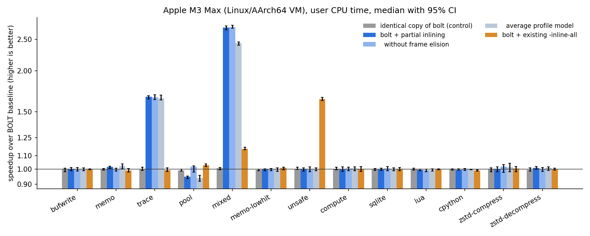

# Profile-Guided Partial Inlining with Frame Elision for LLVM BOLT

| | |
|---|---|
| **Component** | LLVM BOLT (`llvm-bolt`), new pass `partial-inlining` |
| **Base** | llvm-project `main` @ `0a0e65b2e8ff6043d85ab07c4d23ea18bf0b9b7d` (2026-11-06) |
| **Option** | `--partial-inline` (off by default) |
| **Targets** | AArch64 (complete, incl. frame elision), x86-64 (frameless fast paths) |
| **Patch** | [`patches/0001-BOLT-Add-profile-guided-partial-inlining-of-fast-paths.patch`](../patches/0001-BOLT-Add-profile-guided-partial-inlining-of-fast-paths.patch) |

## Contents

1. [Summary](#1-summary)
2. [Problem description](#2-problem-description)
3. [Design](#3-design)
4. [Implementation](#4-implementation)
5. [Experimental evaluation](#5-experimental-evaluation)
6. [When the optimization is (in)effective](#6-when-the-optimization-is-ineffective)
7. [Limitations and future work](#7-limitations-and-future-work)
8. [Reproducing the results](#8-reproducing-the-results)

---

## 1. Summary

Many hot functions consist of a short *fast path* that returns early and a much
larger *slow path*: a cache lookup that hits, a buffer that still has room, a
logging call whose level is disabled, an allocator whose free list is not
empty. They are too large for the compiler to inline, cannot be inlined across
translation units without LTO, and are frequently not shrink-wrapped, so each
call executes a call, a return and the complete prologue and epilogue to run a
handful of useful instructions.

This work adds **profile-guided partial inlining** to BOLT. For every hot direct
call site it copies the callee's hot, acyclic fast region into the caller,

* **elides the callee's stack frame** on the copied path (stack pointer
  updates, callee-saved spills and reloads, frame pointer setup, return address
  signing/authentication, CFI, BTI landing pads),
* **renames** callee-saved registers that the fast path uses as temporaries to
  scratch registers that are provably dead at the call site,
* and **falls back to the original call** on every slow exit. The copied
  region is guaranteed to be side-effect free and *re-executable* on every
  path to a slow exit, so the callee itself is not modified at all.

A conservative **worst-case profile model** compensates for BOLT's
context-insensitive profiles, and the transformation is applied hottest-first
under a coverage budget.

Key results on an Apple M3 Max (Linux/AArch64 VM), BOLT baseline vs. baseline
+ `--partial-inline`, see [Section 5](#5-experimental-evaluation):

* **Up to 2.72x** faster on code dominated by fast-path calls (`mixed` 2.72x,
  `trace` 1.67x, `memo` 1.016x; 13-25% fewer executed instructions). Frame
  elision is what makes `memo` profitable: the compiler did not shrink-wrap
  its callee, and without frame elision the pass does not transform it.
* **Real programs** (SQLite, Lua, CPython, zstd): the pass removes up to 12.7%
  of the direct calls (Lua) and 0.06-0.41% of the executed instructions, but
  no run-time change is measurable. All four programs are within 0.5% of the
  baseline with confidence intervals that include 1.0, like the A/A control
  (a byte-identical copy of the baseline).
* **No regression** on workloads without the pattern or with unsafe fast paths
  (`compute`, `unsafe`, `memo-lowhit`): the pass leaves `unsafe` and
  `memo-lowhit` byte-identical and transforms only a lukewarm call site in
  `compute`; the executed instructions and the run time are unchanged.
* Code growth <= 0.5% on the real programs; BOLT processing time +0.01 to
  +0.04 s.
* One microbenchmark (`pool`) is 5% slower although it executes 25% fewer
  instructions. Section 5.5 shows that this is an interaction of BOLT's
  ext-tsp block layout with a store-to-load chain on this core: with the
  original block order the same partially inlined code is 13.4% faster than
  the baseline, exactly as fast as the compiler's own LTO inlining.
* The evaluation was checked for measurement bias (Section 5.6): profiles are
  reproducible, every variant runs from the same path, and an A/A control
  bounds the resolution at about +-1%. This check showed that the 2.5% Lua
  speedup reported by an earlier snapshot of this work was an artifact: each
  variant ran under its own file name from its own file pages.

The patch adds 7 lit tests (one of them executes PAC-protected binaries end to
end); the full BOLT test suite shows **no change in the result of any existing
test**, and with the option disabled the patched `llvm-bolt` produces
**byte-identical output** to unmodified mainline on all evaluated workloads.

## 2. Problem description

### 2.1 Fast paths pay for the call and the frame

Consider a direct-mapped memoization cache in front of an expensive function,
in a different translation unit than its callers (`benchmarks/micro/memo`):

```c
uint64_t memo_get(uint64_t key) {
  struct entry *e = &cache[(key ^ (key >> 12)) & 4095];
  if (e->key == key + 1)            // ~98% of the calls
    return e->val;
  uint64_t v = expensive(key);      // slow path: call, needs a frame
  e->key = key + 1; e->val = v; memo_misses++;
  return v;
}
```

clang 23 at `-O2` produces (AArch64):

```asm
memo_get:
  stp  x29, x30, [sp, #-0x20]!   ; prologue - executed on every call
  stp  x20, x19, [sp, #0x10]
  mov  x29, sp
  eor  w8, w0, w0, lsr #12
  adrp x9, cache
  add  x9, x9, :lo12:cache
  add  x20, x0, #0x1             ; key+1 kept in callee-saved x20 ...
  and  x8, x8, #0xfff
  add  x19, x9, x8, lsl #4       ; ... and &cache[i] in x19: both are live
  ldr  x8, [x19]                 ;     across the call on the slow path
  cmp  x8, x20
  b.ne .Lmiss
  ldr  x0, [x19, #0x8]           ; fast path result
  b    .Lepilogue
.Lmiss:
  bl   expensive
  ...
.Lepilogue:
  ldp  x20, x19, [sp, #0x10]     ; epilogue - executed on every call
  ldp  x29, x30, [sp], #0x20
  ret
```

The fast path is 10 useful instructions, but every call also executes `bl`,
`ret`, two stores and two loads of callee-saved registers, the frame pointer
setup and two stack pointer updates. Shrink-wrapping (moving the prologue onto
the slow path) is impossible for the compiler because `x19`/`x20` are computed
before the branch and are needed after the call on the slow path, so they must
live in callee-saved registers that have to be saved first. This is not a
corner case: in our microbenchmarks clang 23 did not shrink-wrap 3 of the 6
fast-path functions (`buf_putc`, `memo_get`, `pool_alloc`). GCC 13.3 does not
shrink-wrap `trace_event` either: it executes the complete 320-byte frame
setup, including the stack-canary load and store of Ubuntu's default
`-fstack-protector-strong`, before the level check.

Compilers address this pattern with *partial inlining* (GCC `ipa-split`, LLVM
`PartialInliner`), but only at the IR level within one module (LLVM's pass is
not part of the default pipeline), and never across translation units without
LTO. A post-link optimizer sees the whole program and an accurate profile, but
BOLT currently has no such transformation.

### 2.2 What BOLT offers today

BOLT's `Inliner` (`bolt/lib/Passes/Inliner.cpp`) inlines *whole* functions:

* `--inline-small-functions` only inlines callees whose body is at most
  `--inline-small-functions-bytes` (default 4 bytes, i.e. one instruction on
  AArch64);
* `--inline-all` inlines every call site of every callee that does not touch
  the stack pointer (except via push/pop on x86); on AArch64 any function with
  a frame is only inlined at tail call sites. Neither mode uses the profile to
  select call sites, so they are rarely enabled.

None of BOLT's passes copies *part* of a callee, elides a callee's frame, or
renames registers across function boundaries.

### 2.3 Goal

Remove call, return and frame overhead from the hot fast paths of non-inlined
functions using BOLT's profile, without changing program semantics, without
modifying the callee, and without slowing down code that does not have this
pattern.

## 3. Design

### 3.1 Terminology

For a callee `F`:

* the **fast region** `R` is a set of basic blocks of `F` that contains the
  entry, is acyclic, contains no calls, indirect branches or jump tables, and
  from every block of which a return is reachable within `R`;
* a **fast exit** is a return in `R`;
* a **slow exit** is a CFG edge from a block of `R` to a block outside `R`.

For a call site `S: call F` in caller `G`, the pass creates a copy `R'` of `R`
in `G`. Fast exits of `R'` continue after the call (or return, at tail call
sites); slow exits of `R'` branch to a new block `SLOW` that contains the
original call instruction (with all its annotations: EH landing pad, GNU args
size, RA state, call count) followed by a branch to the code after the call.

```
            G (before)                     G (after)
      +----------------+            +----------------+
      | ...            |            | ...            |
      | bl F           |            +--------+-------+
      | <continue>     |                     v
      +----------------+            +-----------------+ slow exit +--------+
                                    | R' (fast region |---------->| bl F   |
                                    |  of F, no frame)|           +---+----+
                                    +--------+--------+               |
                                    fast exit|                        |
                                             v                        |
                                    +----------------+                |
                                    | <continue>     |<---------------+
                                    +----------------+
```

### 3.2 Correctness: the re-execution fallback

When `R'` takes a slow exit, `F` is called and executes *from its entry*,
re-executing the instructions `R'` already executed. This is equivalent to the
original program if, on every path `P` from the entry of `R` to a slow exit:

1. **No side effects.** No instruction on `P` writes memory or has unmodeled
   side effects (stores, atomics, exclusive accesses, barriers, system
   register writes, ...). Instructions on paths that can no longer reach a slow
   exit (after the fast/slow decision) may store - e.g. the free-list update
   in `pool_alloc` or the buffer append in `buf_putc`.
2. **No register hazard.** No register written on `P` is read on `P` before it
   is defined on `P`. Then, by induction over the instructions of `P`, the
   re-executed `F` reads the same values, takes the same branches, and reaches
   the slow exit with exactly the architectural state of the original call.
3. **Fresh scratch registers.** The scratch registers introduced by renaming
   (3.4) are not read by `F` before being written (they are caller-saved
   non-argument registers and `F`'s own code is checked).

On a fast exit, `R'` has performed exactly `F`'s computation and memory
accesses on that path, except for the elided frame instructions, which only
touch `F`'s own (dead after return) stack frame, the return address register
and callee-saved registers that are restored before `F` returns. Registers
clobbered by `R'` are either clobbered by `F` on the same path or are scratch
registers that are dead after the call (3.4). Because `R'` never changes the
stack pointer, the frame pointer or the link register, the caller's unwind
information remains valid for every instruction of `R'`; `R'` contains no
calls, so it cannot throw.

Concurrency: `R'` only reads memory before a slow exit, so a slow-exit
execution is indistinguishable from an execution in which the discarded
speculative reads never happened and `F` was entered at the time of the call.

### 3.3 Fast region formation

`PartialInlining::buildRegion()` computes `R` from the CFG and the profile:

1. **Candidates**: blocks reachable from the entry through *copyable* blocks
   (no calls, no indirect branches, no jump tables, no EH labels, no landing
   pads, symbolic operands must not reference callee-local labels or jump
   tables; exploration is bounded).
2. **Acyclicity**: blocks on cycles (Tarjan SCC on the candidate subgraph) are
   removed; a loop at the entry rejects `F`.
3. **Usefulness**: keep only blocks from which a return is reachable.
4. **Profile flow**: in topological order compute the flow from the entry
   (`Flow`) and, backwards, the probability of leaving through a fast exit
   (`PFast`) from the edge counts. `FastProb = PFast(entry)`.
5. **Cold pruning**: blocks reached by less than 1% of the invocations are
   removed (they add size and hazards but no benefit).
6. **Frame/dataflow analysis** (3.5) in topological order.
7. **Slow reachability**, **side-effect check** (condition 1) and **hazard
   check** (condition 2, a forward must-define analysis restricted to blocks
   that can reach a slow exit).
8. **Size limits** (`--partial-inline-max-insns`, `--partial-inline-max-blocks`).

Any violation in a non-entry block *prunes* that block (its incoming edges
become slow exits) and the analysis is repeated; a violation in the entry
block rejects the callee. Pruning makes the region the maximal safe and warm
prefix of `F`. When pruning removes all fast exits, the first pruning reason is
reported, which makes the rejection statistics informative.

### 3.4 Register renaming and scratch registers

Callee-saved registers that the fast path writes after spilling them (`x19`,
`x20` in `memo_get`) belong to the *caller* in `R'` and must not be clobbered.
Every occurrence is renamed (including sub-registers, e.g. `w19`) to a scratch
register `s` of the same class. A renamed register may only be read after it
has been written on *every* path (a must-analysis; reading the entry value of a
callee-saved register is rejected).

Callee-side requirements for `s` (computed once per callee): `s` is a
caller-saved, non-argument register (AArch64: `x9`-`x15`, `v16`-`v31`; `x16`/
`x17` are excluded because BOLT's long-branch stubs use them), it is not
referenced by the copied code, and `F` never reads it before writing it
(condition 3).

Call-site requirements: `s` must be dead after the call in `G` *and* in `G`'s
callers. A plain ABI argument is not sufficient: interprocedural register
allocation (GCC's `-fipa-ra`, enabled at `-O2`) lets a caller keep values in
caller-saved registers across calls to callees known not to clobber them. The
pass therefore uses BOLT's interprocedural `RegAnalysis` and accepts `s` if

* the call to `F` already clobbers `s` (`RegAnalysis` clobber set of `F`), or
* a forward search from the call finds no read of `s` before it is redefined
  or clobbered (calls modeled with their `RegAnalysis` clobber/use sets) and,
  if the search reaches an exit of `G`, `G` itself already clobbers `s`.

Either way the clobber set of every function is unchanged by the
transformation, so `RegAnalysis` stays valid while the pass transforms
multiple call sites.

### 3.5 Frame elision

Frame instructions are recognized by a new target hook
`MCPlusBuilder::analyzeFrameInstruction()` that classifies an instruction as
`SPAdjust`, `Save` (registers stored to SP-relative slots, with pre-index
writeback), `Restore`, `FPSetup`, `SignRA`, `AuthRA` or `LandingPad`. A forward
abstract interpretation tracks, per region path, the SP offset relative to the
entry, a map *slot -> register whose entry value is stored there*, the set of
saved registers, the may/must sets of saved registers modified by the body,
whether FP was modified and whether the return address is signed. The rules:

* a save must store the *entry value* of a register into `F`'s own frame (below
  the entry SP) into a fresh slot; a restore must reload a register from the
  slot holding its saved value;
* at every fast exit SP is back at its entry value, all modified saved
  registers have been restored, FP is restored, and the return address is
  either not signed or authenticated by the return itself (`retaa`);
* body (non-frame) instructions must not read or write SP, FP or LR - so the
  fast path may not use locals, spills or stack arguments;
* join points must agree on the frame state.

All frame instructions, CFI and landing pads are dropped from `R'`; the copies
get the CFI state and the pointer-authentication RA state of the call site.

### 3.6 Profile model and call-site selection

BOLT profiles are context-insensitive: `FastProb` describes all calls of `F`
together. A call site that only exercises `F`'s slow path would pay for the
duplicated fast-path check. With the default **worst-case model** the pass
assumes that all `SlowCalls(F) = Count(F)·(1 - FastProb)` invocations could
come from the call site under consideration:

```
p_site = min(FastProb, max(0, 1 - SlowCalls(F) / Count(S)))
```

For a dominant call site `p_site = FastProb`; for a minor call site of a
callee with a significant slow path `p_site` drops to 0. Call sites with
`p_site < --partial-inline-min-fast-ratio` (60%) are skipped. Only call sites
with a count of at least `--partial-inline-min-count` (default: BOLT's hot
threshold, half the average function execution count) are analyzed; they are
transformed in decreasing order of `Count(S)·p_site` until
`--partial-inline-coverage` (99%) of the eligible fast-path calls are covered.
`--partial-inline-profile-model=average` uses `FastProb` for all call sites
(ablation in Sections 5.3 and 5.5).

### 3.7 Profile maintenance

* The copies `R'` receive `Count(S)/Count(F)` of the region flow of `R`; the
  `SLOW` block receives the flow of all slow exits and its call instruction's
  `Count` annotation (used by the call graph for function reordering) is set
  accordingly.
* The callee keeps its code but loses the fast-path flow that now executes in
  the caller: for every block and edge of `R` the pass subtracts
  `Scale·Flow·PFast`, and `F`'s execution count is reduced by the number of
  calls that no longer reach it.

### 3.8 Pipeline placement and interaction with other passes

The pass runs after `Inliner` and the second `IdenticalCodeFolding`, and before
`ReorderBasicBlocks`, `SplitFunctions` and `ReorderFunctions`:

* whole-function inlining keeps priority where it applies;
* block reordering lays out the copied fast path in line with the caller's hot
  path and moves the `SLOW` block out of the way; function splitting can move
  it to the cold fragment;
* function reordering sees the reduced call frequencies;
* `LongJmp`, `AArch64RelaxationPass` and `PointerAuthCFIFixup` handle long
  branches, ADR relaxation and RA state CFIs of the new blocks as for any other
  code. The pass is disabled together with `--instrument`.

### 3.9 Options

| Option | Default | Meaning |
|---|---|---|
| `--partial-inline` | off | enable the pass |
| `--partial-inline-max-insns` | 24 | max. instructions copied per call site |
| `--partial-inline-max-blocks` | 8 | max. blocks in a region |
| `--partial-inline-min-fast-ratio` | 60 | min. fast-path percentage per call site |
| `--partial-inline-profile-model` | `worst-case` | `worst-case` or `average` |
| `--partial-inline-min-count` | 0 (= hot threshold) | min. call site count |
| `--partial-inline-coverage` | 99 | share of eligible fast-path calls to cover |
| `--partial-inline-frame-elision` | on | allow frame elision |
| `--print-partial-inline` | off | print modified functions |
| `--partial-inline-min-block-flow` (hidden) | 1 | cold block pruning threshold (%) |
| `--partial-inline-max-sites` (hidden) | 0 | limit for bisecting |
| `--partial-inline-skip` (hidden) | - | functions never partially inlined |

`-v=1` prints every transformed call site, `-v=2` also prints why a callee has
no usable fast region; `-debug-only=bolt-partial-inline` dumps the analysis.

## 4. Implementation

### 4.1 Code

| File | Change |
|---|---|
| `bolt/include/bolt/Passes/PartialInlining.h`, `bolt/lib/Passes/PartialInlining.cpp` | the pass (~1,400 lines incl. comments) |
| `bolt/include/bolt/Core/MCPlusBuilder.h` | 3 new target hooks with conservative defaults |
| `bolt/lib/Target/AArch64/AArch64MCPlusBuilder.cpp` | AArch64 frame instruction classifier, scratch registers, zero-extension model |
| `bolt/lib/Target/X86/X86MCPlusBuilder.cpp` | `endbr` landing pads, 32-bit zero-extension model |
| `bolt/lib/Rewrite/BinaryPassManager.cpp` | pass registration, `--print-partial-inline` |
| `bolt/docs/*.md` | user documentation, command-line reference, AArch64 status |
| `bolt/test/**/partial-inline*` | 7 lit tests |

The new target hooks are:

* `analyzeFrameInstruction(Inst, FrameInstrInfo&)` - frame instruction
  classification (AArch64: `ADD/SUB SP, SP, #imm`, `ADD FP, SP, #imm`,
  `STP/STR/STUR` and `LDP/LDR/LDUR` of X and D registers with offset, pre- and
  post-index addressing based on SP, `PACI[AB]SP`, `AUTI[AB]SP`, `BTI`).
* `getCallSiteScratchRegs(Reg, Regs)` - ABI scratch registers of the same
  class.
* `getFullyDefinedReg(Reg)` - the register completely defined by a write to
  `Reg` (`W0 -> X0`, `S0 -> Q0` on AArch64; `EAX -> RAX` on x86-64), used to
  make the must-define analysis precise.

The pass is organized in four phases: lazy per-callee analysis
(`analyzeCallee`, `buildRegion`, `computeScratchCandidates`), call-site
collection and selection, transformation (`chooseScratchRegisters`,
`inlineFastPath`, `updateCalleeProfile`; call sites of one block are processed
from the last to the first so recorded positions stay valid), and statistics.
The transformation runs sequentially and is deterministic.

### 4.2 Issues found and fixed during development

Systematic testing on compiler-generated code exposed several subtle issues
that a less careful implementation would get wrong:

| Issue | Consequence | Fix |
|---|---|---|
| A write to `w8` defines all of `x8` on AArch64, but BOLT register sets only contain sub-registers of a written register | spurious hazards (`and x8, x8, ...` after `eor w8, ...`) | `getFullyDefinedReg` hook |
| `XZR`/`WZR` are constant, but their sub-register `WZR_HI` is not marked constant | every `cmp` (writes XZR) and `mov` (reads XZR) looked like a hazard | close the constant set over sub-registers |
| Full alias sets contain register tuples (`X8_X9`, `X8..X15` for `LD64B`) | `x10` conflicted with a region using `x8` | compare *storage* (fully defined register + sub-registers) |
| A renamed register read after a join where only one predecessor wrote it | **miscompile**: scratch register read on the other path | must-dirty analysis; regression test, verified by mutation testing |
| `isPAuthAndRet` aborts on x86 | crash on x86 | query only on AArch64 |
| `x16/x17` are used by BOLT's long-branch stubs without liveness checks | possible clobber of a renamed value | exclude from scratch candidates |
| GCC `-fipa-ra` callers keep values in caller-saved registers | possible miscompile with ABI-only reasoning | `RegAnalysis`-based scratch selection (3.4) |
| Cold slow-path blocks reaching returns entered the region | spurious hazards, size | cold pruning + conflict-driven pruning |

### 4.3 Testing

* **Lit tests** (all new, all passing):
  * `AArch64/partial-inline-frameless.s` - CFG after the pass (copied blocks,
    slow block, profile counts, call count annotation), callee unchanged,
    callee profile reduced, pass off without the option;
  * `AArch64/partial-inline-frame-elision.s` - prologue/epilogue elision and
    renaming of `x19`/`x20`; with frame elision disabled the callee is rejected;
  * `AArch64/partial-inline-reject.s` - 10 hot callees that must not be
    transformed (store before the decision, barrier, clobbered argument, SP use,
    LR use, stack argument, unrestored callee-saved register, partially written
    renamed register, cold fast path, loop at entry);
  * `AArch64/partial-inline-sites.s` - tail call sites, worst-case vs. average
    model, `--partial-inline-min-fast-ratio`, `--partial-inline-min-count`;
  * `AArch64/partial-inline-pauth.s` - BTI landing pads and PAC signing/
    authentication are elided, RA states stay consistent;
  * `X86/partial-inline.s` - frameless fast path with `endbr64`, stack-using
    callee rejected;
  * `runtime/AArch64/partial-inline.c` - end to end on the host: compile at
    `-O2`, instrument, train, optimize, run, compare outputs; repeated with
    `-mbranch-protection=standard`, which on this CPU (FEAT_PAuth) faults on a
    wrong frame elision.
* **Mutation test** for the must-dirty fix: re-introducing the bug makes
  `partial-inline-reject.s` fail.
* **Regression**: `check-bolt` for unmodified mainline and the patched tree with
  the same toolchain ([Section 5.7](#57-correctness-and-regression-testing)).
* **x86-64**: 9 programs validated end to end under emulation (Section 5.7).
* **Output equivalence**: every benchmark run of every variant is checked
  against the output of the original binary (exit code and SHA-256 of stdout).
* **Flag-off identity**: the patched `llvm-bolt` without `--partial-inline`
  produces byte-identical binaries to mainline `llvm-bolt`.

## 5. Experimental evaluation

All numbers in this section come from one continuous run of
`scripts/run_experiments.sh` in the Docker image built from this repository
(`make image experiments`); the results are in [`results/`](../results/) (raw per-run CSV files, summaries,
`REPORT.md`, plots, BOLT logs).

### 5.1 Setup

| | |
|---|---|
| Hardware | Apple M3 Max (12 performance + 4 efficiency cores), FEAT_PAuth |
| OS | Docker Desktop 4.98 Linux VM, kernel 7.0.14 (aarch64), 12 vCPUs, 31 GiB; Ubuntu 24.04 container. An unrelated, mostly idle database container (about 3% of one vCPU) ran on the same VM |
| Compiler | clang/lld 23.1.6 (apt.llvm.org), no LTO, no PGO, `-Wl,--emit-relocs`; `-O2` for the microbenchmarks, SQLite and Lua, the projects' default `-O3` for CPython and zstd |
| BOLT | mainline `0a0e65b2e8ff` (Release + assertions), baseline and patched |
| Profile | BOLT instrumentation (`-instrument`) on *training* inputs that are smaller than (zstd: different from) the evaluation inputs; the same profile is used for all variants. Profiles, and therefore all BOLT outputs, are byte-for-byte reproducible: the training runs execute with address space layout randomization disabled (`setarch -R`), CPython with `PYTHONHASHSEED=0`, and Lua is built with a fixed hash seed (`-Dluai_makeseed()=0u`) instead of one derived from the clock and a stack address. Without these measures Lua, SQLite and CPython produce a slightly different profile in every run, because some of their hash tables depend on addresses |

Variants of every workload (`scripts/bolt_variants.sh`):

| Variant | Options |
|---|---|
| `orig` | compiler output |
| `bolt` | `-reorder-blocks=ext-tsp -reorder-functions=cdsort -split-functions -split-all-cold -split-eh -icf=1` (**baseline**) |
| `bolt-copy` | byte-identical copy of `bolt` (A/A control) |
| `bolt-pi` | `bolt` + `--partial-inline` (**this work**, default settings) |
| `bolt-pi-avg` | `bolt-pi` with `--partial-inline-profile-model=average` (ablation) |
| `bolt-pi-nofe` | `bolt-pi` with `--partial-inline-frame-elision=false` (ablation) |
| `bolt-inl` | `bolt` + BOLT's existing `-inline-all -inline-ap` |
| `bolt-inl-pi` | `bolt-inl` + `--partial-inline` |

Methodology (`scripts/bench.py`): every round runs all variants of a workload
once in a rotated order after a warm-up run; 15 rounds for microbenchmarks, 30
for the real programs. The metric is the user CPU time of the process (from
`wait4`). Because the host's CPU state drifts over minutes (the VM's vCPUs are
scheduled by macOS; we observed two performance levels ~8% apart that last for
several rounds), the primary statistic is **paired**: the median over rounds of
`t(bolt, r) / t(variant, r)`, with a 95% bootstrap confidence interval and a
two-sided Wilcoxon signed-rank test. Unpaired statistics are also stored. The
standard output (and exit code) of every single run is compared with the
original binary.

Two measures remove biases that are not caused by the code of a variant
(Section 5.6 explains why they are needed):

* **Same path, fresh pages.** Every single run first copies the variant's
  binary to a new file `/stage/prog` (a tmpfs) and executes that copy. All
  variants therefore run under the same path, which fixes the initial stack
  layout (`argv[0]` and `AT_EXECFN` are copied onto the stack), and every run
  gets newly allocated pages for the binary instead of the same physical
  pages for the whole session. Without this, two byte-identical binaries
  (`unsafe`: `bolt` and `bolt-pi`, where the pass changes nothing) differed by
  1.5% with p = 0.003 in an earlier run.
* **A/A control.** The variant `bolt-copy`, a byte-identical copy of `bolt`, is
  measured like every other variant. Its "speedup" shows how large a
  difference the method reports when there is none.

Timing runs keep ASLR enabled, so that every run sees a different placement of
stack, heap and libraries.

Deterministic metrics complement the timings: executed instructions (valgrind
`cachegrind --cache-sim=no`, `scripts/icount.py`), BOLT's profile-based dyno
stats, code size, and BOLT processing time. The instruction counts also run
every variant from the same path. This matters: Lua caches C strings in a
table indexed by their address (`luaS_new`), and many of them are stack
buffers. Run under their own file names, two variants that differ only in
function order executed up to 0.6% more or fewer instructions; run from the
same path, they execute exactly the same number.

### 5.2 Workloads

| Workload | Class | Pattern |
|---|---|---|
| `bufwrite` | target | buffered byte writer: room in the buffer -> append (store after the decision); not shrink-wrapped |
| `memo` | target | memoization cache hit (98%); not shrink-wrapped, callee-saved temporaries |
| `trace` | target | disabled tracing hook with a 256-byte stack frame on the slow path (shrink-wrapped) |
| `pool` | target | free-list allocator (`pool_alloc` with frame, `pool_free` frameless) |
| `mixed` | adversarial | one callee, an always-fast and an always-slow call site (aggregate 75% fast) |
| `memo-lowhit` | neutral | same binary as `memo`, 30% hit rate: fast path too cold |
| `unsafe` | neutral | hot fast paths that are *unsafe* to re-execute (store before the decision, clobbered argument) |
| `compute` | neutral | call-free CRC-32C and matrix multiplication kernels |
| `sqlite` | real | SQLite 3.54.1 `speedtest1 --size 60 --memdb` (train: `--size 20`) |
| `lua` | real | Lua 5.5.1, interpreter mix (calls, GC, floating point, strings, tables, OOP) |
| `cpython` | real | CPython 3.14.10, interpreter mix (calls, objects, dicts, regex, JSON, generators, floating point) |
| `zstd-compress`/`-decompress` | real | zstd 1.5.7 level 3 on 148 MB / 592 MB of Python sources (train: C sources) |

### 5.3 Run time

Speedup over `bolt` (higher is better), median of paired per-round ratios with
95% CI; `p` refers to `bolt-pi` (see `results/REPORT.md` for all CIs and
p-values). `bolt-copy` is the A/A control: its deviations from 1.000 show the
resolution of the measurement.

| Workload | `bolt-copy` (A/A) | `bolt-pi` | `bolt-pi-avg` | `bolt-pi-nofe` | `bolt-inl` | p |
|---|---|---|---|---|---|---:|
| bufwrite | 1.002 [0.982, 1.007] | 1.001 [0.988, 1.012] | 1.001 | 0.999 | 0.999 | 0.76 |
| memo | 0.998 [0.994, 1.005] | **1.016** [1.005, 1.021] | 1.023 | 1.001 | 0.990 | 0.035 |
| trace | 0.998 [0.990, 1.015] | **1.667** [1.639, 1.681] | 1.648 | 1.658 | 0.993 | 6.1e-05 |
| pool | 0.991 [0.987, 0.999] | 0.949 [0.936, 0.953] | 0.940 | 1.019 | 1.028 | 6.1e-05 |
| mixed | 1.007 [0.995, 1.011] | **2.715** [2.670, 2.745] | 2.438 | 2.719 | 1.153 | 6.1e-05 |
| memo-lowhit | 0.995 [0.989, 1.000] | 1.000 [0.989, 1.001] | 0.997 | 0.997 | 1.009 | 0.45 |
| unsafe | 1.003 [0.997, 1.013] | 1.002 [0.985, 1.009] | 1.000 | 0.997 | 1.640 | 0.98 |
| compute | 1.002 [0.995, 1.013] | 0.999 [0.983, 1.017] | 1.005 | 1.005 | 1.004 | 0.93 |
| sqlite | 0.997 [0.990, 1.005] | 0.997 [0.991, 1.007] | 0.997 | 1.004 | 1.003 | 0.87 |
| lua | 1.000 [0.993, 1.008] | 0.995 [0.988, 1.001] | 0.994 | 0.993 | 1.000 | 0.27 |
| cpython | 0.998 [0.994, 1.001] | 0.997 [0.993, 1.002] | 0.998 | 0.999 | 0.991 | 0.07 |
| zstd-compress | 1.002 [0.981, 1.010] | 1.003 [0.982, 1.017] | 1.014 | 1.018 | 1.004 | 0.84 |
| zstd-decompress | 0.996 [0.986, 1.008] | 1.008 [0.997, 1.018] | 1.009 | 1.003 | 0.998 | 0.12 |



The A/A control stays within 0.991-1.007 on all 13 workloads; its 95% CI
excludes 1.0 once (`pool`, barely), as expected for 13 comparisons at 95%.
Differences of less than about 1% are therefore not resolvable in this
environment, and only `trace`, `mixed`, `memo` (gains) and `pool` (loss) show
a run-time effect of `bolt-pi`. For reference, the BOLT baseline itself is
6.4% faster than `orig` on CPython, 3.8% on Lua and 2.6% on SQLite.

### 5.4 Deterministic metrics and what the pass did

Executed instructions (valgrind) and profile-estimated calls (BOLT dyno stats)
of `bolt-pi` relative to `bolt`, and the transformation statistics:

| Workload | instructions | calls | call sites (frame elided / tail) | copied insns | renamed regs | .text growth |
|---|---:|---:|---|---:|---:|---:|
| bufwrite | -23.85% | -99.9% | 1 (1 / 0) | 10 | 2 | -3.5% |
| memo | -16.28% | -95.1% | 1 (1 / 0) | 10 | 2 | +0.5% |
| trace | -15.98% | -100% | 2 (0 / 0) | 8 | 0 | +3.0% |
| pool | -24.97% | -100% | 2 (1 / 0) | 16 | 1 | +9.2% (92 B) |
| mixed | -12.96% | -70.8% | 3 (0 / 0) | 15 | 0 | +3.6% |
| memo-lowhit | 0.00% | 0% | 0 | 0 | 0 | 0 |
| unsafe | 0.00% | 0% | 0 | 0 | 0 | 0 |
| compute | 0.00% | -3.4% | 1 (cold CRT code) | 3 | 0 | +40 B |
| sqlite | -0.06% | -2.2% | 8 (3 / 0) | 96 | 7 | +0.03% |
| lua | -0.41% | -10.2% | 14 (4 / 2) | 151 | 3 | +0.44% |
| cpython | -0.28% | -3.3% | 14 (5 / 1) | 158 | 3 | +0.09% |
| zstd | 0.00% | -0.65% | 5 (0 / 0) | 29 | 0 | +0.24% |

BOLT processing time grows from 1.18 s to 1.21 s for CPython (37 MB binary)
and from 0.38 s to 0.42 s for SQLite; the pass itself is linear in the number
of hot call sites, and `RegAnalysis` is only built if a fast region needs
renaming. Where the pass changes nothing (`unsafe`, `memo-lowhit`), the
executed instruction count is identical to the instruction; for zstd and
`compute`, where it only transforms lukewarm call sites, it differs by at most
3,518 instructions (0.001%).

The reasons why callees of hot call sites in the real programs have no usable
fast region are dominated by `no-fast-exit` (every return path contains a call)
and calls in the entry block - fast paths that call other functions are out of
scope by design. Store-before-decision (`side-effect`) and clobbered argument
registers (`reg-clobber`) account for 4-8 callees per program (see
`REPORT.md`).

### 5.5 Analysis

**Where the speedup comes from.** For `trace` the whole call disappears: the
loop executes two disabled trace points per iteration, each formerly a `bl`, a
4-instruction check and a `ret`. For `memo` the fast path executed 18
instructions plus the call, including 4 stack accesses (two of which update
SP) and the frame pointer setup; the
copy executes 10 and no stack access (stores -95%, loads -48% in the dyno
stats). Without frame elision `memo` is not transformed at all (the callee is
not shrink-wrapped), which is why `bolt-pi-nofe` gains nothing there. `mixed`
combines both effects and is the case where the profile model matters (below).

**Instruction count is not everything.** `bufwrite` executes 24% fewer
instructions but is not measurably faster (1.001): its loop is bound by the
store-to-load dependency chain through `b->pos` in memory, which inlining does
not shorten (only the compiler could keep `pos` in a register).

**The profile model.** In `mixed`, `classify()` is called 3x per iteration from
a site that always takes the fast path and once from a site that always takes
the slow path. The average model inlines both sites; the slow site then
executes the copied check and the original call (re-execution). The worst-case
model only transforms the always-fast site and is 11.4% faster (2.72x vs.
2.44x). On the other workloads the two models give the same run time within
the measurement resolution.

**The `pool` slowdown.** `pool` executes 25% fewer instructions but runs 4-5%
slower. A dedicated experiment (`scripts/pool_analysis.sh`, 15 rounds, its own
A/A control: 1.002 [1.000, 1.004]):

| Variant | Speedup vs. bolt |
|---|---|
| partial inlining, ext-tsp layout (default) | 0.959 [0.956, 0.961] |
| only `pool_alloc` / only `pool_free` partially inlined | 1.021 / 1.030 |
| partial inlining, original block order (`-reorder-blocks=none`) | **1.134** [1.129, 1.137] |
| baseline with original block order | 1.001 [0.997, 1.003] |
| partial inlining, `-reorder-blocks=cache` | 1.030 |
| compiler LTO (inlines both functions) | **1.134** [1.132, 1.139] |

The partially inlined code is therefore as fast as the compiler's own inlining
when the inlined `pool_free` (three stores to `p->free`, `p->live`, `n->next`)
and `pool_alloc` (loads of exactly these locations) are separated by taken
branches; laid out as one straight-line sequence by ext-tsp, it takes 18%
longer than with the original block order. Alignment does not matter
(`-align-blocks` with 32/64-byte boundaries gives the same result). The likely
cause is the memory-dependence speculation of the core when loads issue right
behind stores to the same addresses whose data arrives late; we cannot confirm
it because the PMU is not available inside the VM. This is a property of the
block layout of two adjacent inlined calls on this microarchitecture, not of
the transformation; Section 7 lists mitigations.

**Real programs.** In Lua, 14 call sites are transformed, removing 10.2% of
the calls (12.7% of the direct calls): Lua C API and auxiliary library
functions called across translation units from the standard library
(`lua_type`, `lua_absindex`, `lua_pushnumber`, the string buffer helper
`prepbuffsize` with frame elision), table insertion (`mainpositionTV` into
`insertkey`, frame elided), comparisons (`luaV_lessthan` at a tail call site),
a GC helper (`luaC_checkfinalizer`) and table sizing (`luaO_ceillog2`). This
saves 0.41% of the executed instructions: the 6.9 million avoided calls
(training input) are frequent, but each saves only a few instructions, and the
run time is unchanged within the resolution (0.995 [0.988, 1.001]). In CPython and SQLite the pass removes 3.3% and 2.2%
of the calls, but the hottest candidates are either below the 60% fast-path
threshold (`PyLong_FromLong`: fewer than 60% of its calls hit the small-int
cache in this workload), call other functions on every path (`_Py_Dealloc`), or store before
the fast/slow decision (`sqlite3BtreeNext`). The remaining 0.06-0.28% of the
instructions are far below the resolution of the timing. zstd is dominated by
loops in a few large functions; the pass finds only lukewarm call sites.

### 5.6 Measurement validity

Several effects unrelated to the code under test were found while reviewing
the evaluation, and are now controlled:

* **Address-dependent execution.** Lua caches C strings in a 53-entry table
  indexed by the string's address (`luaS_new`); many of these strings are
  stack buffers. The start of the stack depends on the path of the executable
  (`argv[0]` and `AT_EXECFN` are copied onto it) and, with ASLR, on a random
  offset. Two BOLT variants that differ *only* in function order executed up
  to 0.6% more or fewer instructions when run under their own file names, and
  exactly the same number when run from the same path. With ASLR, the training
  profiles of Lua, SQLite and CPython differed in every run, and so did their
  BOLT outputs. Training now runs under `setarch -R` (profiles verified
  byte-identical in three separate containers), and every timed or counted run
  executes a fresh copy of the binary at the same path.
* **Per-binary bias.** Before this change, two byte-identical binaries (`unsafe`,
  where the pass changes nothing) differed by 1.5% with p = 0.003, and Lua
  showed a "speedup" of 1.7-2.6% in several runs. Pairing rounds cannot remove
  a bias that is fixed per file for the whole session (its path, its pages in
  the page cache). With the fresh same-path copy the A/A control is within
  +-1% everywhere and the Lua speedup is gone. The 2.5% Lua speedup reported by
  an earlier, unversioned snapshot of this repository was such an artifact.
* **Nondeterministic workloads.** Lua seeds its string hash from the clock and
  a stack address and CPython randomizes string hashing per process; Lua is
  built with a fixed seed and CPython runs with `PYTHONHASHSEED=0`.
* **Instruction attribution.** valgrind cannot read the symbols of the code
  segment that BOLT adds ("ELF section outside all mapped regions") and
  attributes that code to unrelated functions, even in shared libraries.
  Only whole-process instruction counts are therefore reported.

The remaining limitations of the environment are listed in Section 7.

### 5.7 Correctness and regression testing

* **BOLT test suite** (`check-bolt`, identical toolchain for both builds,
  `results/check-bolt/`):

  | Result | mainline | patched |
  |---|---:|---:|
  | PASS | 689 | 696 (689 + 7 new) |
  | UNSUPPORTED | 138 | 138 |
  | XFAIL | 1 | 1 |
  | FAIL | 1 | 1 |

  No existing test changes its result; the only failure
  (`AArch64/icp-inline.c`) fails on unmodified mainline with this toolchain as
  well.
* **Flag-off identity** (`results/flag-off-identity.txt`): for all 12 workload
  binaries, with the layout options and with `-inline-all`, the patched
  `llvm-bolt` without `--partial-inline` writes byte-identical binaries to
  unmodified mainline (after removing the `.note.bolt_info` section, which
  records the BOLT revision and the command line).
* **Output verification**: 8 variants x (8 x 16 + 5 x 31) = 2,264 runs plus
  160 runs of the `pool` analysis, every output identical to the original
  program's output.
* **x86-64 functional validation** (`scripts/x86_validate.sh`,
  `results/x86-validation.txt`): the 7 microbenchmarks, the end-to-end test
  program and Lua 5.5.1 were compiled natively for x86-64 (Ubuntu clang 18,
  without CET; `endbr64` landing pads are covered by the lit test
  `X86/partial-inline.s`), profiled with BOLT instrumentation and
  optimized with the patched `llvm-bolt`, and executed under Docker's amd64
  emulation: all 9 programs produce identical output for the original, `bolt`
  and `bolt-pi` binaries (10 transformed call sites in Lua). Callees whose fast
  path has a `push`-based frame (`bufwrite`, `memo`) are, as designed, not
  transformed on x86-64. Run time was not measured under emulation.
* **End-to-end runtime test with pointer authentication**
  (`runtime/AArch64/partial-inline.c`, built with
  `-mbranch-protection=standard`): the frame-elided fast paths execute with
  real return address signing on FEAT_PAuth hardware.

## 6. When the optimization is (in)effective

**Effective** - programs that spend a significant fraction of their time in
calls to functions that

* are not inlined by the compiler (different translation unit without LTO,
  too large as a whole, `noinline`, or only partially hot),
* have an early-exit fast path taken by >= 60% of the calls of a call site
  (worst-case estimate) - caches, buffers, free lists, disabled logging and
  tracing, argument and state checks, interpreter helpers,
* whose fast path does not call other functions and only reads memory before
  the fast/slow decision,
* and especially when the compiler could not shrink-wrap them (frame elision
  removes the prologue and epilogue as well, Section 2.1).

Typical candidates: allocator front ends, buffered I/O, logging and tracing
frameworks, memoization layers, reference-counted object systems whose release
path checks first, and C/C++ code bases built without LTO. Interpreters have
many such call sites (Lua: 12.7% of the direct calls removed), but in the
programs we measured the saved instructions (at most 0.41%) were too few for
a measurable run-time gain.

**Ineffective (and left unchanged)**:

* compute kernels dominated by loops without calls (`compute`, zstd);
* code that the compiler already inlined (LTO builds; small `static inline`
  helpers);
* fast paths taken by less than 60% of a call site's calls (`memo-lowhit`),
  call sites below BOLT's hot threshold;
* fast paths that are unsafe to re-execute: stores, atomics or barriers before
  the decision (reference-count decrement, lock acquisition), arguments
  overwritten before the decision (`unsafe`);
* fast paths that call other functions, contain loops or jump tables, or use
  the stack (locals, spills, stack arguments, `alloca`, a stack-protector
  canary set up before the decision as GCC does for `trace_event`);
* loops bound by memory dependency chains (`bufwrite`): fewer instructions but
  no speedup.

In all ineffective cases measured, the run time is unchanged (all confidence
intervals of `bolt-pi` include 1.0, as for the A/A control), and in most of
them the pass does not modify the executed code at all.

## 7. Limitations and future work

* **Layout interaction** (`pool`): two partially inlined calls whose fast paths
  store to and load from the same memory locations can be slower when ext-tsp
  places them back to back. Possible mitigations: a layout constraint that
  keeps a taken branch between such sequences, store-to-load forwarding in
  registers for adjacent inlined fast paths (a binary-level redundant load
  elimination), or a cost model trained with hardware counters on bare metal.
* **Clobbered argument registers** (`ldr x0, [x0]` before the decision): a
  flow-sensitive renaming of the register on paths to slow exits, with a copy
  back at fast exits, would make these regions re-executable.
* **Stores before the decision**: instead of re-executing the callee, the slow
  exit could enter the callee at the slow-exit block through a new secondary
  entry point with the frame state of that point.
* **x86-64 frame elision**: needs a classifier for `push`/`pop`/`leave` and
  scratch registers (`r10`, `r11`); currently only frameless fast paths are
  copied on x86-64 (validated by lit tests and end to end under emulation;
  performance not measured).
* **Context-insensitive profiles**: the worst-case model is conservative and
  may skip profitable call sites of callees with many callers; call-site
  specific path profiles (e.g. from instrumentation that records the caller)
  would remove the uncertainty.
* **System register reads** (`mrs` of the thread pointer in TLS-based fast
  paths) are treated as side effects; a whitelist of side-effect free system
  register reads would admit thread-local allocator fast paths.
* **Debugging**: copied instructions have no line information, the callee
  does not appear in stack traces taken on its fast path, and BOLT address
  translation maps them to the caller.
* **Volatile/MMIO loads** before the decision are executed twice on slow paths
  (harmless for normal memory); `--partial-inline-skip` excludes functions.
* **Stack-protector canaries** that are set up before the fast/slow decision
  (GCC places them in the prologue of functions with arrays) are stores to the
  stack and make the fast path ineligible; recognizing the canary sequence as
  frame code would admit them.
* **Measurement environment**: all measurements were taken in a Linux VM on an
  Apple M3 Max without access to hardware counters, with a resolution of about
  +-1% (A/A control). The small instruction savings on the real programs
  (0.06-0.41%) could only be confirmed in run time on bare metal with
  hardware counters or many more repetitions. Results on other cores, in
  particular x86-64, were not measured.

## 8. Reproducing the results

On an AArch64 Linux host (or Docker Desktop on Apple silicon), from the
repository root:

```bash
make image          # baseline + patched BOLT, check-bolt for both, workloads
make check-bolt     # results/check-bolt/: test results of both builds, compared
make experiments    # scripts/run_experiments.sh, writes results/ (about 35 min)
make x86-validate   # Section 5.7, x86-64 under emulation
```

`results/timeline.log` and `results/environment.txt` record when each step of
the run happened and on which machine and toolchain. The BOLT test-suite
results of both builds are in the image (`/opt/bolt-baseline/check-bolt.log`,
`/opt/bolt-patched/check-bolt.log`, `lit-results.json`).
